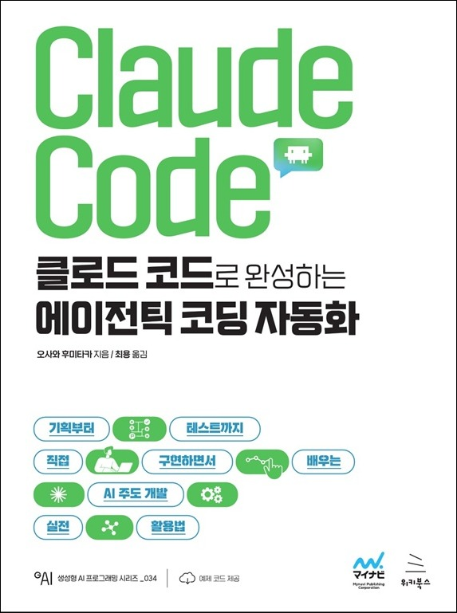

# 클로드 코드로 완성하는 에이전틱 코딩 자동화
### 기획부터 테스트까지 직접 구현하면서 배우는 AI 주도 개발 실전 활용법

- **오사와 후미타카** 지음 | **최용** 옮김
- ISBN: 9791158397036
- 판형: 175\*235\*17mm
- 28,000원 | 2026년 10월 7일 발행 | 424쪽
- [책 홈페이지](https://wikibook.co.kr/agentic-coding/)
- [도서 미리보기](http://www.yes24.com/Product/Viewer/Preview/196791321)
- [도서 관련 문의](https://wikibook.co.kr/support/contact/)

---

**클로드 코드에 더 많이 맡기려면 지시와 검증의 틀을 먼저 세워야 합니다!**

바이브 코딩으로 개발한 애플리케이션은 겉보기에는 잘 작동하는 것처럼 보입니다. 하지만 정말로 올바르게 구현했다고 확신할 수 있을까요?

이 책은 개발 흐름 안에서 클로드 코드를 안전하게 활용하는 방법을 안내합니다. 독자는 작은 퍼즐 게임부터 PDF 라벨 출력, PHP와 Laravel 프레임워크를 활용한 본격적인 웹 애플리케이션 개발까지 실습하면서, 클로드 코드를 실제 업무에 활용할 때 무엇을 AI에 맡기고 사람은 어떤 기준을 세워야 하는지 배웁니다.

처음 시작하는 개발자는 격리된 개발 환경에서 설치와 기본 조작을 따라갈 수 있고, 이미 일부 기능만 쓰던 개발자는 기본 조작 너머의 설계, 테스트 자동화, 권한 관리, 리뷰까지 사용 범위를 넓힐 수 있습니다. AI를 무조건 믿고 맡기는 것이 아니라, 정밀한 명세와 테스트 케이스를 준비하고 사람이 확인하는 개발 방식을 제안합니다.

**★ 이 책에서 다루는 내용 ★**

- Docker DevContainer로 내 PC와 격리된 프로젝트별 개발 환경 만들기
- CLAUDE.md와 Plan 모드로 설계를 정하고 단계적으로 개발하기
- 데이터베이스와 인증을 갖춘 PHP+Laravel 웹 애플리케이션 개발하기
- 테스트 케이스 작성부터 TDD와 E2E 테스트 자동화까지 검증 체계 세우기
- 스킬과 커스텀 서브에이전트로 반복 작업 효율화하기
- /permissions와 settings.json으로 권한을 관리하고 코드 리뷰로 보안 점검하기

---
 
 ## 구입처
 
 - [예스24](https://www.yes24.com/product/goods/196791321)
 - [교보문고](https://product.kyobobook.co.kr/detail/S000221384304)
 - [알라딘](https://www.aladin.co.kr/shop/wproduct.aspx?ItemId=402747384)
 - [영풍문고](https://www.ypbooks.co.kr/books/202609218868418600)
 - [쿠팡](https://www.coupang.com/vp/products/9743534247?itemId=29165793176&vendorItemId=96087651612)