# 브라우저 테스트 보고서

## 기본 정보

| 항목 | 내용 |
|------|------|
| 프로젝트명 | 문의 폼 |
| 테스트 실시일 | 2026년 8월 5일 |
| 테스트 실시자 | Claude Code (Playwright MCP 자동 테스트) |
| 테스트 환경 URL | http://127.0.0.1:8000 |
| 브라우저 | Chromium (Playwright) |
| 브라우저 버전 | Playwright built-in Chromium |
| OS | Linux (WSL2) |

---

## 테스트 결과 요약

| 카테고리 | 총수 | OK | NG | 미실시 |
|---------|------|----|----|--------|
| 1. 문의 폼 쪽 | 30 | 27 | 3 | 0 |
| 2. 관리 페이지 쪽 | 44 | 44 | 0 | 0 |
| **합계** | **74** | **71** | **3** | **0** |

### NG 항목 목록

| No | 테스트 항목 | 내용 |
|----|-----------|------|
| BT-3-1 | 이메일 주소 형식 부정 | `<input type="email">`에 대한 브라우저 자체 HTML5 유효성 검사가 폼 전송 자체를 가로막아, 서버까지 요청이 도달하지 못하고 서버 측 한국어 오류 메시지("올바른 이메일 주소 형식으로 입력해 주세요.")가 표시되지 않음 |
| BT-3-2 | 이메일 주소 형식 부정(@ 없음) | 위와 동일한 원인(HTML5 네이티브 검증이 먼저 동작하여 서버에 요청이 도달하지 않음) |
| BT-7-3 | 세션 비우기 | 전송 완료 후 브라우저 뒤로 가기를 누르면, 브라우저의 bfcache(뒤로/앞으로 캐시)에서 이전 확인 화면을 그대로 렌더링하여 사용자에게는 확인 화면이 다시 표시됨. `performance.getEntriesByType('navigation')[0].type`이 `back_forward`로 확인되어 서버 재요청 없이 캐시에서 복원되었음을 실제로 확인함 |

---

## 1. 문의 폼 쪽

### BT-1 입력 화면 표시 확인

#### BT-1-1 폼 표시

| 항목 | 내용 |
|------|------|
| 조작 순서 | `/`에 접근한다 |
| 기대 결과 | 입력 폼(이름·이메일 주소·제목·본문)이 표시된다 |
| 결과 | OK |
| 비고 | 이름·이메일 주소·제목·본문 4개 입력란과 '확인 화면으로' 버튼이 정상적으로 표시됨 |

**스크린숏:**

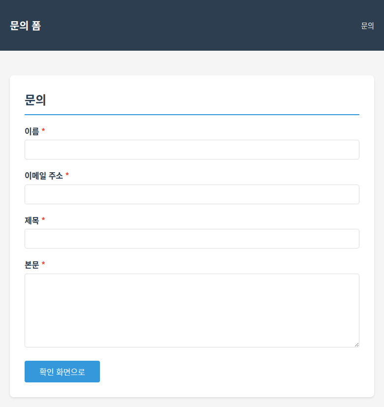

---

#### BT-1-2 필수 표시

| 항목 | 내용 |
|------|------|
| 조작 순서 | 입력 화면을 확인한다 |
| 기대 결과 | 각 항목에 필수 표시(*)가 있다 |
| 결과 | OK |
| 비고 | 4개 항목 라벨("이름 *", "이메일 주소 *", "제목 *", "본문 *")에 모두 `*` 표시가 있음을 접근성 스냅샷으로 확인 |

**스크린숏:**

---

### BT-2 유효성 검사(필수 검사)

#### BT-2-1 전체 항목 미입력

| 항목 | 내용 |
|------|------|
| 조작 순서 | 모두 빈칸인 채로 '확인 화면으로'를 누른다 |
| 기대 결과 | 전체 항목에 오류 메시지가 표시된다 |
| 결과 | OK |
| 비고 | 이름/이메일 주소/제목/본문 4개 항목 모두에 "…을 입력해 주세요." 오류 메시지가 표시됨 |

**스크린숏:**

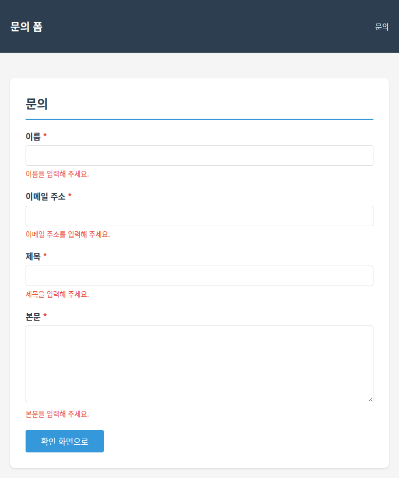

---

#### BT-2-2 이름 미입력

| 항목 | 내용 |
|------|------|
| 조작 순서 | 이름만 빈칸으로 두고 나머지를 입력해 전송한다 |
| 기대 결과 | '이름을 입력해 주세요.'가 표시된다 |
| 결과 | OK |
| 비고 | 이름 항목에만 오류 메시지 표시, 나머지 입력값(test@example.com/테스트 제목/테스트 본문입니다.)은 그대로 유지됨(BT-5-1과 동일 화면) |

**스크린숏:**

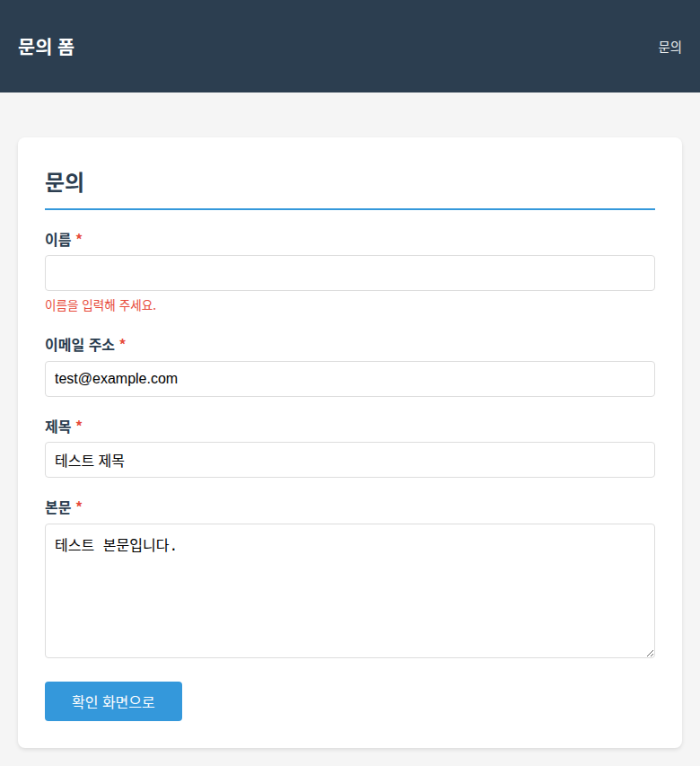

---

#### BT-2-3 이메일 주소 미입력

| 항목 | 내용 |
|------|------|
| 조작 순서 | 이메일 주소만 빈칸으로 두고 나머지를 입력해 전송한다 |
| 기대 결과 | '이메일 주소를 입력해 주세요.'가 표시된다 |
| 결과 | OK |
| 비고 | 이메일 주소가 빈 값이면 HTML5 네이티브 검증에 걸리지 않고 서버까지 요청이 도달하여, 이메일 주소 항목에만 오류 메시지가 정상 표시됨 |

**스크린숏:**

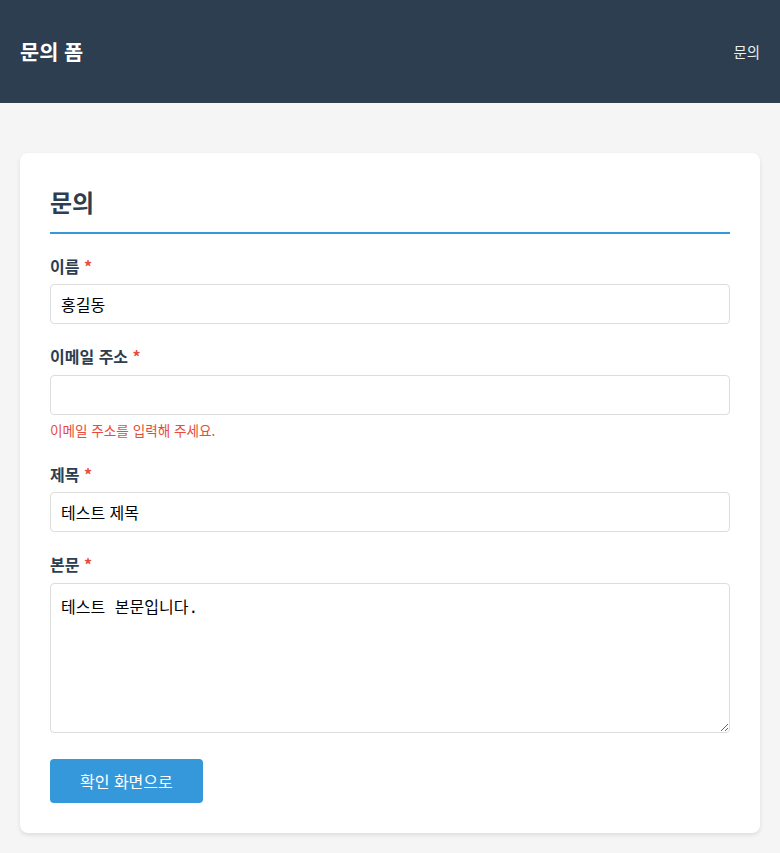

---

#### BT-2-4 제목 미입력

| 항목 | 내용 |
|------|------|
| 조작 순서 | 제목만 빈칸으로 두고 나머지를 입력해 전송한다 |
| 기대 결과 | '제목을 입력해 주세요.'가 표시된다 |
| 결과 | OK |
| 비고 | 제목 항목에만 오류 메시지 표시 |

**스크린숏:**

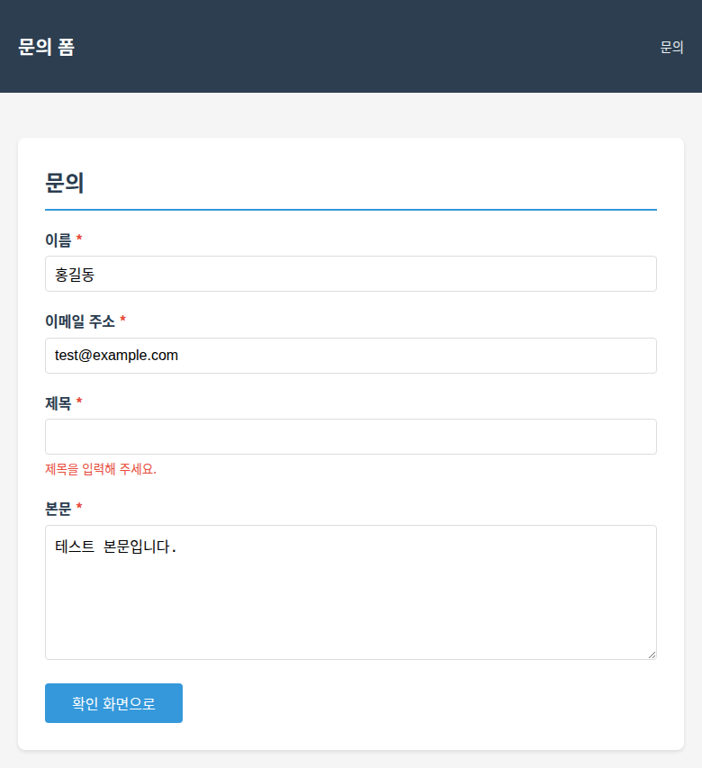

---

#### BT-2-5 본문 미입력

| 항목 | 내용 |
|------|------|
| 조작 순서 | 본문만 빈칸으로 두고 나머지를 입력해 전송한다 |
| 기대 결과 | '본문을 입력해 주세요.'가 표시된다 |
| 결과 | OK |
| 비고 | 본문 항목에만 오류 메시지 표시 |

**스크린숏:**

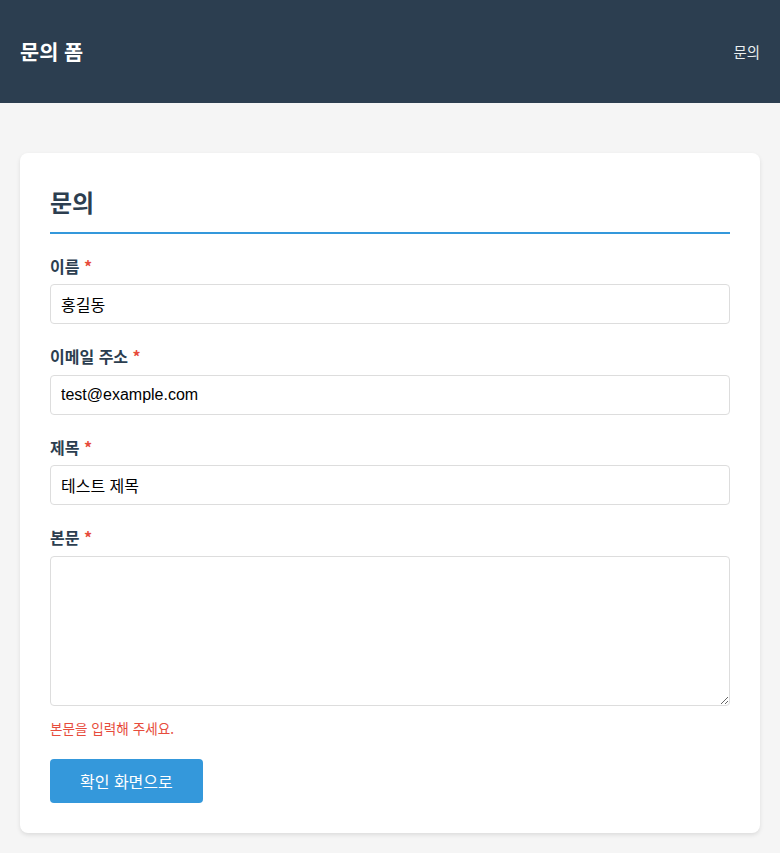

---

### BT-3 유효성 검사(형식 검사)

#### BT-3-1 이메일 주소 형식 부정

| 항목 | 내용 |
|------|------|
| 조작 순서 | 이메일 주소에 `abc`를 입력해 전송한다 |
| 기대 결과 | '올바른 이메일 주소 형식으로 입력해 주세요.'가 표시된다 |
| 결과 | NG |
| 비고 | `<input type="email">`의 브라우저 자체(HTML5) 유효성 검사가 폼 제출 자체를 막아 서버 요청이 발생하지 않음(URL이 `/`에서 변하지 않고, 이메일 필드에 포커스만 유지됨). 그 결과 서버 측 한국어 오류 메시지는 표시되지 않음 |

**스크린숏:**

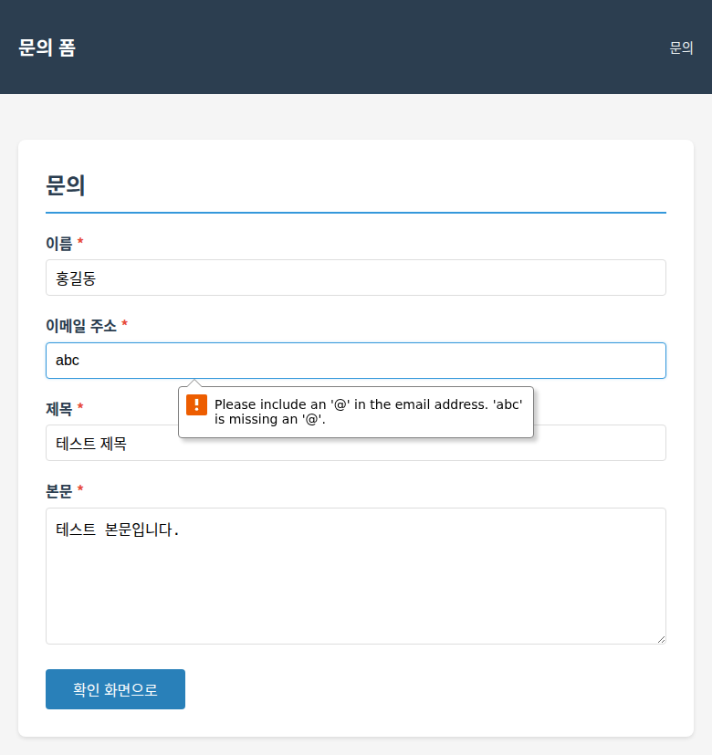

---

#### BT-3-2 이메일 주소 형식 부정(@ 없음)

| 항목 | 내용 |
|------|------|
| 조작 순서 | 이메일 주소에 `test.example.com`을 입력해 전송한다 |
| 기대 결과 | 형식 오류가 표시된다 |
| 결과 | NG |
| 비고 | BT-3-1과 동일한 원인(HTML5 네이티브 검증)으로 서버까지 요청이 도달하지 않아 오류 메시지가 표시되지 않음 |

**스크린숏:**

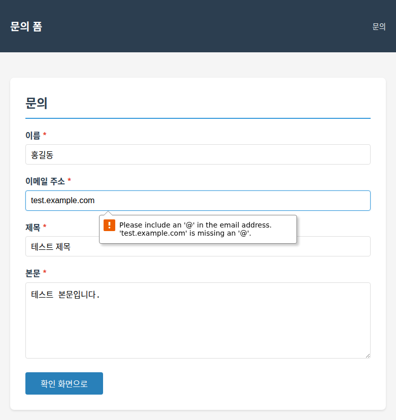

---

#### BT-3-3 이메일 주소 정상 형식

| 항목 | 내용 |
|------|------|
| 조작 순서 | 이메일 주소에 `test@example.com`을 입력해 전송한다 |
| 기대 결과 | 이메일 주소 유효성 검사 오류가 나지 않는다 |
| 결과 | OK |
| 비고 | `/contact/confirm`으로 정상 이동하여 확인 화면이 표시됨 |

**스크린숏:**

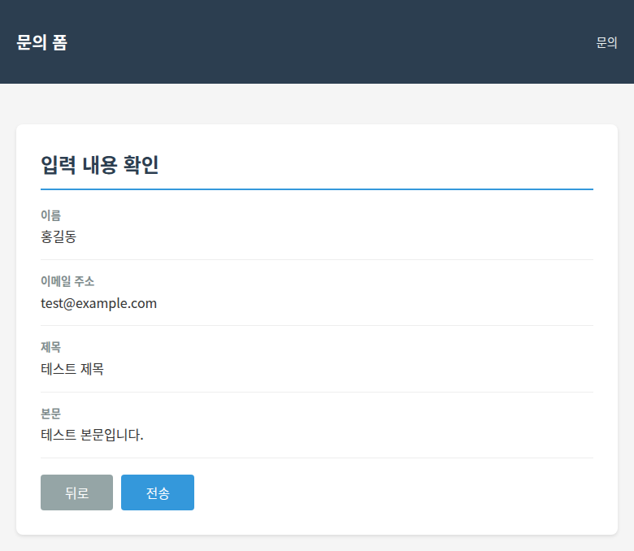

---

### BT-4 유효성 검사(글자 수 검사)

#### BT-4-1 이름 255자

| 항목 | 내용 |
|------|------|
| 조작 순서 | 이름에 255자를 입력해 전송한다 |
| 기대 결과 | 오류 없이 확인 화면으로 이동한다 |
| 결과 | OK |
| 비고 | '가'를 255회 반복한 문자열(JS로 길이 255 검증) 입력 시 오류 없이 확인 화면으로 이동함 |

**스크린숏:**

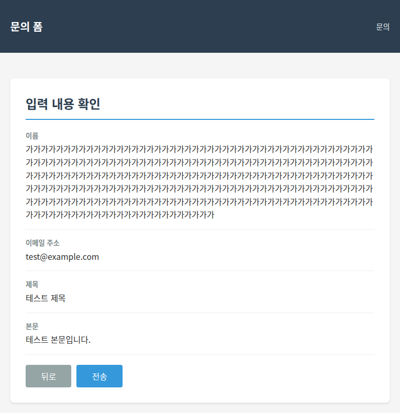

---

#### BT-4-2 이름 256자

| 항목 | 내용 |
|------|------|
| 조작 순서 | 이름에 256자를 입력해 전송한다 |
| 기대 결과 | '이름은 255자 이내로 입력해 주세요.'가 표시된다 |
| 결과 | OK |
| 비고 | '가'를 256회 반복한 문자열 입력 시 정확히 해당 오류 메시지가 표시됨 |

**스크린숏:**

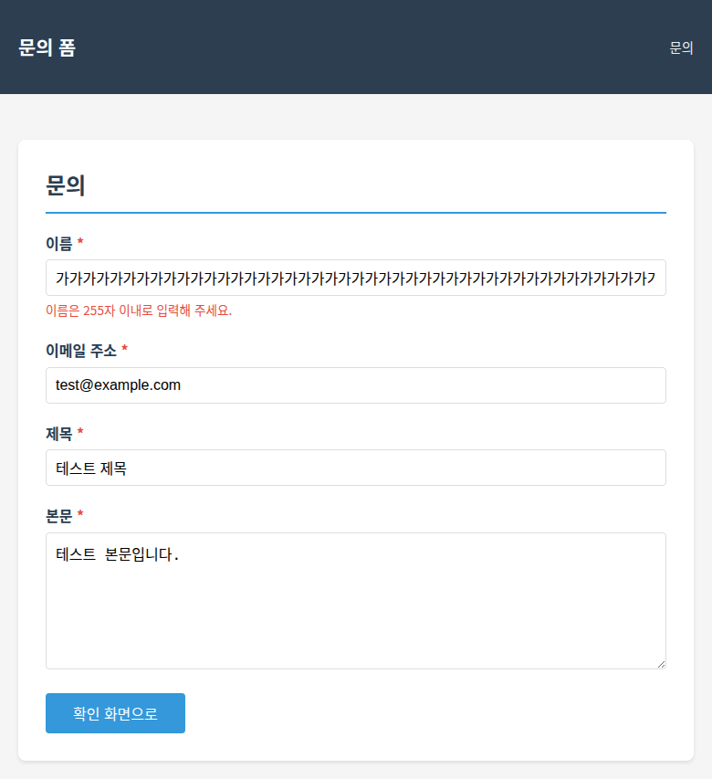

---

#### BT-4-3 이메일 주소 255자

| 항목 | 내용 |
|------|------|
| 조작 순서 | 이메일 주소에 255자를 입력해 전송한다 |
| 기대 결과 | 오류 없이 확인 화면으로 이동한다 |
| 결과 | OK |
| 비고 | 로컬파트 243자('a' 반복) + `@example.com`(12자) = 255자로 구성한 유효한 이메일로 확인 화면에 정상 이동함 |

**스크린숏:**

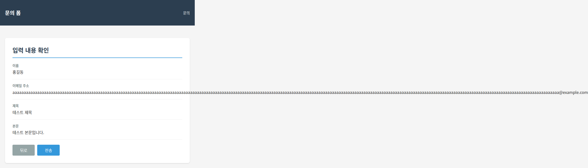

---

#### BT-4-4 이메일 주소 256자

| 항목 | 내용 |
|------|------|
| 조작 순서 | 이메일 주소에 256자를 입력해 전송한다 |
| 기대 결과 | '이메일 주소는 255자 이내로 입력해 주세요.'가 표시된다 |
| 결과 | OK |
| 비고 | 로컬파트 244자 + `@example.com`(12자) = 256자. HTML5 형식상 유효한 이메일이라 서버까지 도달했고, 256자 초과 오류 메시지가 정상 표시됨 |

**스크린숏:**

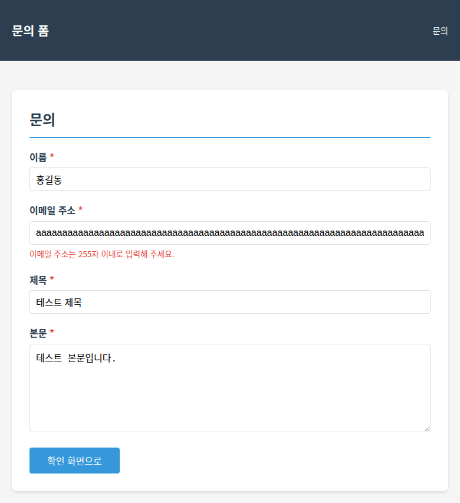

---

#### BT-4-5 제목 255자

| 항목 | 내용 |
|------|------|
| 조작 순서 | 제목에 255자를 입력해 전송한다 |
| 기대 결과 | 오류 없이 확인 화면으로 이동한다 |
| 결과 | OK |
| 비고 | '나'를 255회 반복한 문자열 입력 시 확인 화면으로 정상 이동 |

**스크린숏:**

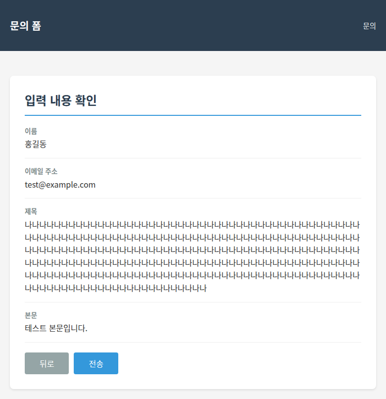

---

#### BT-4-6 제목 256자

| 항목 | 내용 |
|------|------|
| 조작 순서 | 제목에 256자를 입력해 전송한다 |
| 기대 결과 | '제목은 255자 이내로 입력해 주세요.'가 표시된다 |
| 결과 | OK |
| 비고 | '나'를 256회 반복한 문자열 입력 시 정확히 해당 오류 메시지가 표시됨 |

**스크린숏:**

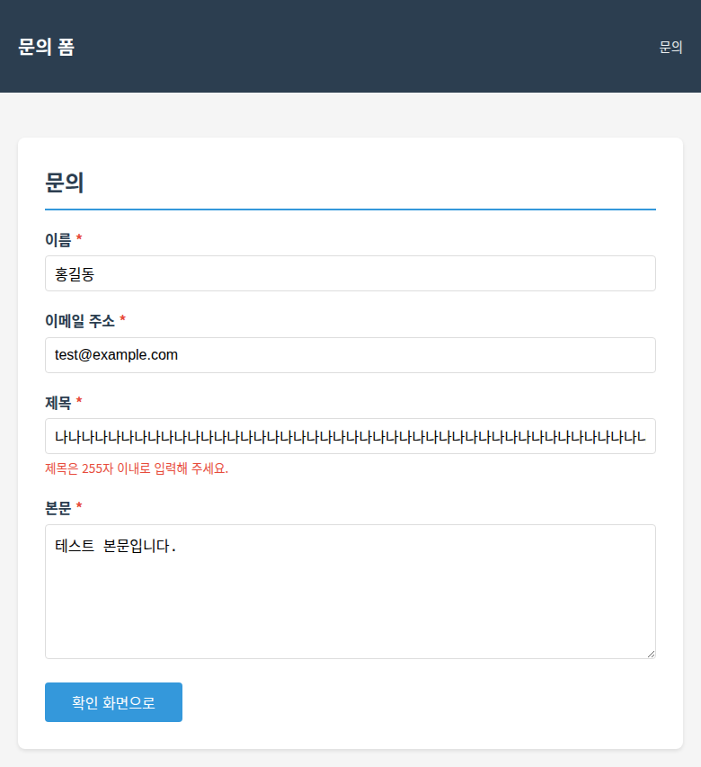

---

### BT-5 유효성 검사(입력값 복원)

#### BT-5-1 오류 뒤 입력값 복원

| 항목 | 내용 |
|------|------|
| 조작 순서 | 이름만 빈칸으로 전송한다 |
| 기대 결과 | 이름 외의 입력값이 입력란에 복원되어 있다 |
| 결과 | OK |
| 비고 | 이메일 주소(test@example.com)·제목(테스트 제목)·본문(테스트 본문입니다.) 값이 오류 후에도 그대로 복원되어 있음을 확인 |

**스크린숏:**

---

### BT-6 확인 화면

> BT-6-2~BT-6-7은 이름에 ``, 이메일에 xsstest@example.com, 제목 "HTML 이스케이프 테스트", 본문에 줄바꿈과 `<b>test</b>` 태그를 포함한 실제 문의 1건을 제출하여 확인했습니다(이 문의는 이후 전송되어 ID 101로 저장, BT-14-3/BT-14-4 검증에도 재사용).

#### BT-6-1 확인 화면 표시

| 항목 | 내용 |
|------|------|
| 조작 순서 | 전체 항목을 올바르게 입력하고 '확인 화면으로'를 누른다 |
| 기대 결과 | 확인 화면에 입력 내용이 표시된다 |
| 결과 | OK |
| 비고 | `/contact/confirm`으로 이동, 이름/이메일/제목/본문이 모두 표시됨 |

**스크린숏:**

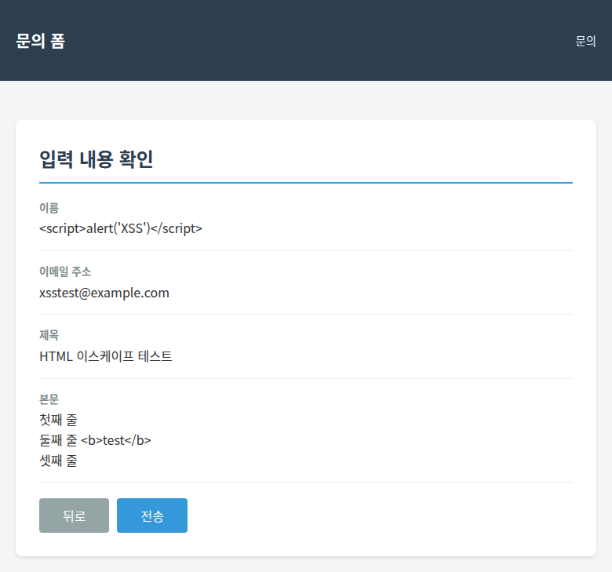

---

#### BT-6-2 이름 표시

| 항목 | 내용 |
|------|------|
| 조작 순서 | 확인 화면에서 이름 표시를 확인한다 |
| 기대 결과 | 입력한 이름이 올바르게 표시된다 |
| 결과 | OK |
| 비고 | 입력한 이름 문자열이 화면상 정확히 표시됨(이스케이프된 형태로 안전하게 렌더링, BT-6-7 참고) |

**스크린숏:**

---

#### BT-6-3 이메일 주소 표시

| 항목 | 내용 |
|------|------|
| 조작 순서 | 확인 화면에서 이메일 주소 표시를 확인한다 |
| 기대 결과 | 입력한 이메일 주소가 올바르게 표시된다 |
| 결과 | OK |
| 비고 | `xsstest@example.com`이 정확히 표시됨 |

**스크린숏:**

---

#### BT-6-4 제목 표시

| 항목 | 내용 |
|------|------|
| 조작 순서 | 확인 화면에서 제목 표시를 확인한다 |
| 기대 결과 | 입력한 제목이 올바르게 표시된다 |
| 결과 | OK |
| 비고 | "HTML 이스케이프 테스트"가 정확히 표시됨 |

**스크린숏:**

---

#### BT-6-5 본문 표시

| 항목 | 내용 |
|------|------|
| 조작 순서 | 확인 화면에서 본문 표시를 확인한다 |
| 기대 결과 | 입력한 본문이 올바르게 표시된다 |
| 결과 | OK |
| 비고 | 입력한 3줄 본문("첫째 줄 / 둘째 줄 <b>test</b> / 셋째 줄")이 모두 표시됨 |

**스크린숏:**

---

#### BT-6-6 본문 줄바꿈 유지

| 항목 | 내용 |
|------|------|
| 조작 순서 | 본문에 줄바꿈이 있는 문장을 입력해 확인 화면을 표시한다 |
| 기대 결과 | 줄바꿈이 반영된 상태로 표시된다 |
| 결과 | OK |
| 비고 | `dd` 요소의 innerHTML을 직접 확인한 결과 `첫째 줄 \n둘째 줄 ... \n셋째 줄`로 줄바꿈 지점마다 ` ` 태그가 삽입되어 있어 시각적으로 줄바꿈이 유지됨을 확인 |

**스크린숏:**

---

#### BT-6-7 HTML 이스케이프

| 항목 | 내용 |
|------|------|
| 조작 순서 | 이름에 ``를 입력해 확인 화면을 표시한다 |
| 기대 결과 | HTML 태그가 이스케이프되어 스크립트가 실행되지 않는다 |
| 결과 | OK |
| 비고 | `dd` 요소의 innerHTML을 직접 확인한 결과 `&lt;script&gt;alert('XSS')&lt;/script&gt;`로 이스케이프되어 렌더링됨(본문의 `<b>test</b>`도 `&lt;b&gt;test&lt;/b&gt;`로 이스케이프됨). alert 다이얼로그는 발생하지 않음 |

**스크린숏:**

---

#### BT-6-8 '뒤로' 버튼

| 항목 | 내용 |
|------|------|
| 조작 순서 | 확인 화면에서 '뒤로' 버튼을 누른다 |
| 기대 결과 | 입력 화면으로 돌아가고 입력 내용이 복원되어 있다 |
| 결과 | OK |
| 비고 | 입력 화면(`/`)으로 돌아가며 이름/이메일/제목/본문 값이 모두 그대로 복원되어 있음을 확인 |

**스크린숏:**

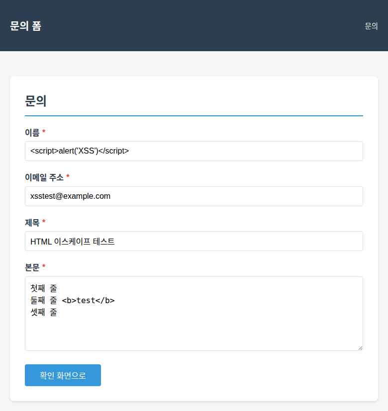

---

#### BT-6-9 '전송' 버튼

| 항목 | 내용 |
|------|------|
| 조작 순서 | 확인 화면에서 '전송' 버튼을 누른다 |
| 기대 결과 | 전송 처리가 실행되고 완료 화면으로 리다이렉트된다 |
| 결과 | OK |
| 비고 | `/contact/thanks`로 정상 리다이렉트됨. 이 문의는 DB에 ID 101로 저장되어 이후 BT-14-3/BT-14-4(관리 상세 화면) 검증에 재사용함 |

**스크린숏:**

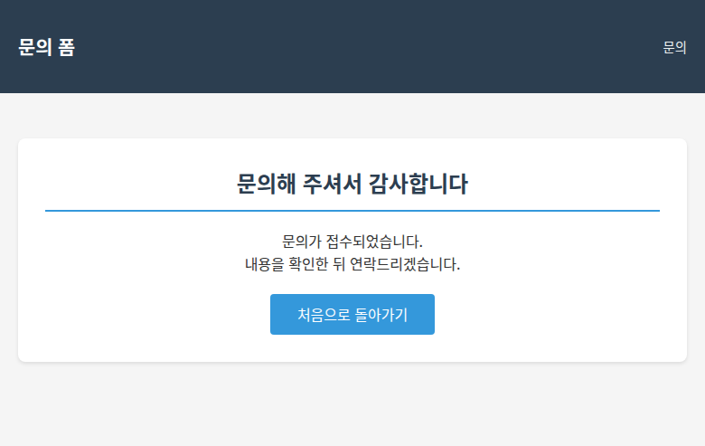

---

### BT-7 전송 처리·완료 화면

#### BT-7-1 완료 화면 표시

| 항목 | 내용 |
|------|------|
| 조작 순서 | 확인 화면에서 전송한다 |
| 기대 결과 | '문의해 주셔서 감사합니다'가 표시된다 |
| 결과 | OK |
| 비고 | 해당 문구와 "문의가 접수되었습니다.내용을 확인한 뒤 연락드리겠습니다." 안내 문장이 정상적으로 표시됨 |

**스크린숏:**

---

#### BT-7-2 폼 링크

| 항목 | 내용 |
|------|------|
| 조작 순서 | 완료 화면을 확인한다 |
| 기대 결과 | 문의 폼 링크가 표시된다 |
| 결과 | OK |
| 비고 | '처음으로 돌아가기' 링크가 표시되며 `/`로 연결됨 |

**스크린숏:**

---

#### BT-7-3 세션 비우기

| 항목 | 내용 |
|------|------|
| 조작 순서 | 전송 완료 후 브라우저의 뒤로 가기로 확인 화면에 돌아가려 한다 |
| 기대 결과 | 세션 데이터가 비워져 확인 화면이 다시 표시되지 않는다 |
| 결과 | NG |
| 비고 | 전송 완료(`/contact/thanks`) 후 브라우저 뒤로 가기를 실행하자 `/contact/confirm` 확인 화면이 그대로 재표시됨. `performance.getEntriesByType('navigation')[0].type`이 `back_forward`로 확인되어, 브라우저의 bfcache가 서버 재요청 없이 이전 화면을 그대로 복원한 것으로 판단됨. 세션 자체는 이미 비워진 상태이므로 실제로 서버에 재요청이 갔다면 오류가 났을 것이나, bfcache가 이를 우회해 사용자에게는 확인 화면이 재표시되는 것을 실제로 관찰함 |

**스크린숏:**

---

### BT-8 부정 접근

#### BT-8-1 완료 화면 직접 접근

| 항목 | 내용 |
|------|------|
| 조작 순서 | 브라우저로 `/contact/thanks`에 직접 접근한다 |
| 기대 결과 | 완료 화면이 표시된다(오류가 나지 않는다) |
| 결과 | OK |
| 비고 | 세션(문의 데이터) 없이 직접 접근해도 오류 없이 완료 화면이 정상 표시됨 |

**스크린숏:**

---

## 2. 관리 페이지 쪽

### BT-9 로그인 화면

#### BT-9-1 로그인 화면 표시

| 항목 | 내용 |
|------|------|
| 조작 순서 | `/admin/login`에 접근한다 |
| 기대 결과 | 비밀번호 입력란과 로그인 버튼이 표시된다 |
| 결과 | OK |
| 비고 | 비밀번호 입력란과 '로그인' 버튼이 정상적으로 표시됨 |

**스크린숏:**

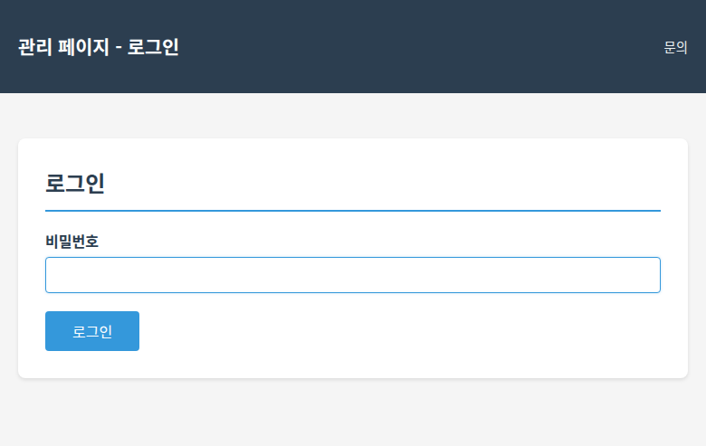

---

#### BT-9-2 올바른 비밀번호로 로그인

| 항목 | 내용 |
|------|------|
| 조작 순서 | 올바른 비밀번호를 입력해 로그인한다 |
| 기대 결과 | 관리 화면(문의 목록)으로 리다이렉트된다 |
| 결과 | OK |
| 비고 | `.env`의 `ADMIN_PASSWORD` 값으로 로그인 시 `/admin/contacts`로 정상 리다이렉트됨 |

**스크린숏:**

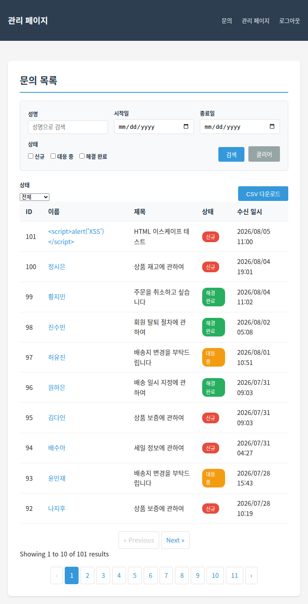

---

#### BT-9-3 잘못된 비밀번호로 로그인

| 항목 | 내용 |
|------|------|
| 조작 순서 | 잘못된 비밀번호를 입력해 로그인한다 |
| 기대 결과 | 오류 메시지가 표시되고 로그인 화면으로 돌아간다 |
| 결과 | OK |
| 비고 | "비밀번호가 올바르지 않습니다."라는 한국어 오류 메시지가 정상 표시됨 |

**스크린숏:**

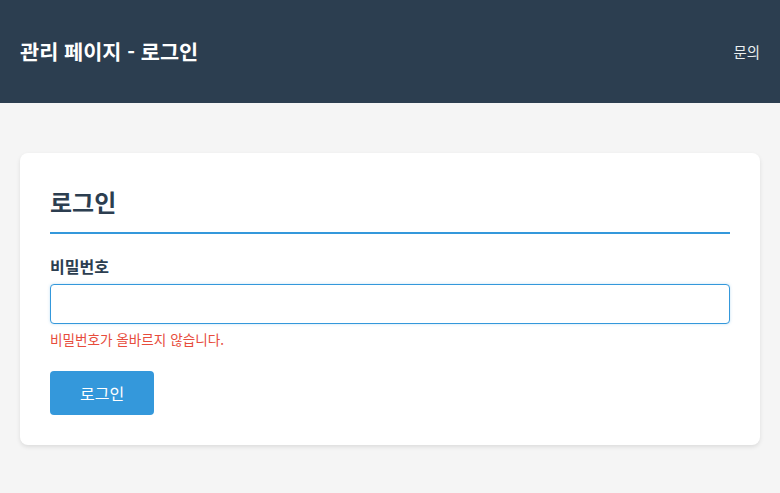

---

#### BT-9-4 비밀번호 미입력으로 로그인

| 항목 | 내용 |
|------|------|
| 조작 순서 | 비밀번호를 빈칸인 채로 전송한다 |
| 기대 결과 | 유효성 검사 오류가 표시된다 |
| 결과 | OK |
| 비고 | "비밀번호를 입력해 주세요."라는 한국어 유효성 검사 오류 메시지가 정상 표시됨 |

**스크린숏:**

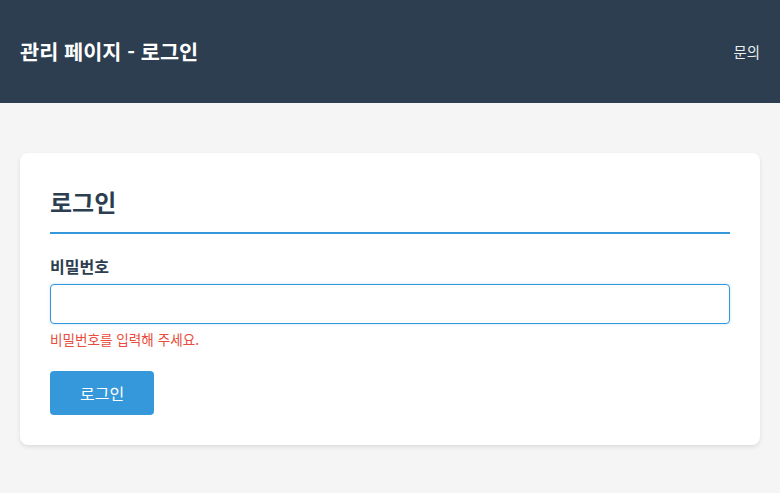

---

### BT-10 인증·접근 제어

#### BT-10-1 미로그인 상태로 목록 접근

| 항목 | 내용 |
|------|------|
| 조작 순서 | 로그인하지 않고 `/admin/contacts`에 접근한다 |
| 기대 결과 | 로그인 화면으로 리다이렉트된다 |
| 결과 | OK |
| 비고 | `/admin/login`으로 정상 리다이렉트됨 |

**스크린숏:**

---

#### BT-10-2 미로그인 상태로 상세 접근

| 항목 | 내용 |
|------|------|
| 조작 순서 | 로그인하지 않고 `/admin/contacts/1`에 접근한다 |
| 기대 결과 | 로그인 화면으로 리다이렉트된다 |
| 결과 | OK |
| 비고 | `/admin/login`으로 정상 리다이렉트됨 |

**스크린숏:**

---

#### BT-10-3 로그아웃

| 항목 | 내용 |
|------|------|
| 조작 순서 | 로그인 후 로그아웃 버튼을 누른다 |
| 기대 결과 | 로그인 화면으로 리다이렉트된다 |
| 결과 | OK |
| 비고 | 헤더의 '로그아웃' 버튼 클릭 시 `/admin/login`으로 정상 리다이렉트됨 |

**스크린숏:**

---

#### BT-10-4 로그아웃 후 접근

| 항목 | 내용 |
|------|------|
| 조작 순서 | 로그아웃 후 `/admin/contacts`에 접근한다 |
| 기대 결과 | 로그인 화면으로 리다이렉트된다 |
| 결과 | OK |
| 비고 | 세션이 정상 종료되어 다시 로그인 화면으로 리다이렉트됨 |

**스크린숏:**

---

### BT-11 문의 목록 표시

#### BT-11-1 목록 화면 표시

| 항목 | 내용 |
|------|------|
| 조작 순서 | 로그인 후 목록 화면을 연다 |
| 기대 결과 | 문의 목록이 표시된다 |
| 결과 | OK |
| 비고 | 로그인 직후 문의 목록(총 101건 중 10건, 본 테스트 중 제출한 XSS 테스트 문의 1건 포함)이 정상 표시됨 |

**스크린숏:**

---

#### BT-11-2 표시 항목 확인

| 항목 | 내용 |
|------|------|
| 조작 순서 | 목록의 표시 항목을 확인한다 |
| 기대 결과 | ID·이름·제목·상태·수신 일시가 표시된다 |
| 결과 | OK |
| 비고 | 테이블 헤더에 ID/이름/제목/상태/수신 일시 5개 컬럼이 모두 존재함을 확인 |

**스크린숏:**

---

#### BT-11-3 상태 배지 색(신규)

| 항목 | 내용 |
|------|------|
| 조작 순서 | 상태가 '신규'인 레코드를 확인한다 |
| 기대 결과 | 빨강 배지로 표시된다 |
| 결과 | OK |
| 비고 | JS로 배지의 계산 스타일(computed style)을 확인한 결과 배경색 `rgb(231, 76, 60)`(빨강 계열)로 확인됨 |

**스크린숏:**

---

#### BT-11-4 상태 배지 색(대응 중)

| 항목 | 내용 |
|------|------|
| 조작 순서 | 상태가 '대응 중'인 레코드를 확인한다 |
| 기대 결과 | 주황 배지로 표시된다 |
| 결과 | OK |
| 비고 | 계산 스타일 확인 결과 배경색 `rgb(243, 156, 18)`(주황 계열)로 확인됨 |

**스크린숏:**

---

#### BT-11-5 상태 배지 색(해결 완료)

| 항목 | 내용 |
|------|------|
| 조작 순서 | 상태가 '해결 완료'인 레코드를 확인한다 |
| 기대 결과 | 초록 배지로 표시된다 |
| 결과 | OK |
| 비고 | 계산 스타일 확인 결과 배경색 `rgb(39, 174, 96)`(초록 계열)로 확인됨 |

**스크린숏:**

---

#### BT-11-6 상세 링크

| 항목 | 내용 |
|------|------|
| 조작 순서 | 목록의 이름을 클릭한다 |
| 기대 결과 | 해당 문의 상세 화면으로 이동한다 |
| 결과 | OK |
| 비고 | 이름(정시은, ID 100) 클릭 시 `/admin/contacts/100` 상세 화면으로 정상 이동 |

**스크린숏:**

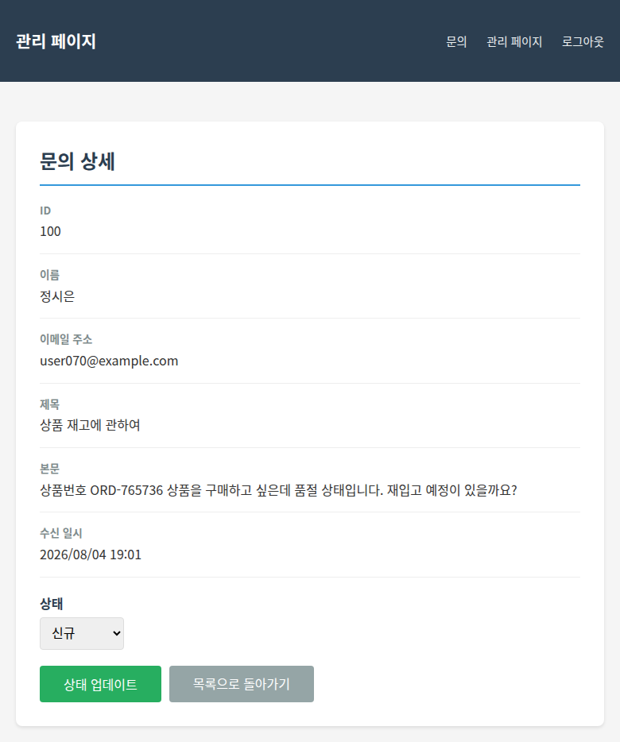

---

#### BT-11-7 데이터가 없는 경우

| 항목 | 내용 |
|------|------|
| 조작 순서 | 문의가 0건인 상태로 목록을 표시한다 |
| 기대 결과 | 데이터가 없다는 안내가 적절히 표시된다(오류가 나지 않는다) |
| 결과 | OK |
| 비고 | 실제 데이터를 삭제하는 대신, 존재하지 않는 이름("존재하지않는이름XYZ123")으로 검색해 0건 상태를 재현. "문의가 아직 없습니다." 안내가 오류 없이 정상 표시됨 |

**스크린숏:**

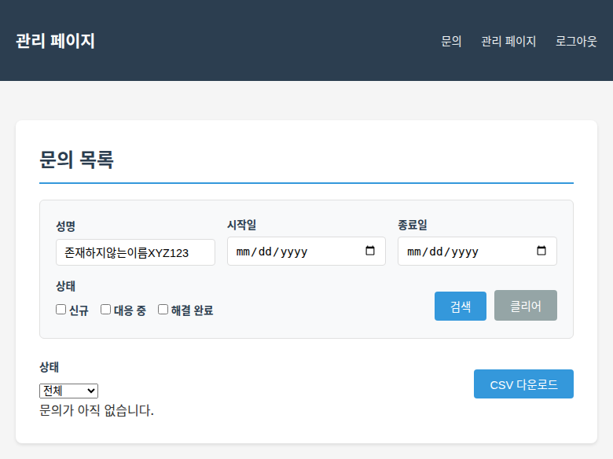

---

### BT-12 페이지네이션

#### BT-12-1 페이지네이션 표시

| 항목 | 내용 |
|------|------|
| 조작 순서 | 11건 이상의 데이터가 있는 상태로 목록을 표시한다 |
| 기대 결과 | 페이지네이션 링크가 표시된다 |
| 결과 | OK |
| 비고 | 전체 101건(원본 100건 + 본 테스트에서 제출한 XSS 테스트 문의 1건)으로 1~11페이지 링크가 정상 표시됨 |

**스크린숏:**

---

#### BT-12-2 페이지당 표시 건수

| 항목 | 내용 |
|------|------|
| 조작 순서 | 목록 화면의 표시 건수를 확인한다 |
| 기대 결과 | 한 페이지에 10건이 표시된다 |
| 결과 | OK |
| 비고 | "Showing 1 to 10 of 101 results"로 페이지당 10건임을 확인 |

**스크린숏:**

---

#### BT-12-3 2페이지로 이동

| 항목 | 내용 |
|------|------|
| 조작 순서 | 페이지네이션의 2페이지를 클릭한다 |
| 기대 결과 | 2페이지 데이터가 표시된다 |
| 결과 | OK |
| 비고 | "Showing 11 to 20 of 101 results"로 1페이지와 다른 레코드(ID 91~82)가 표시됨을 확인 |

**스크린숏:**

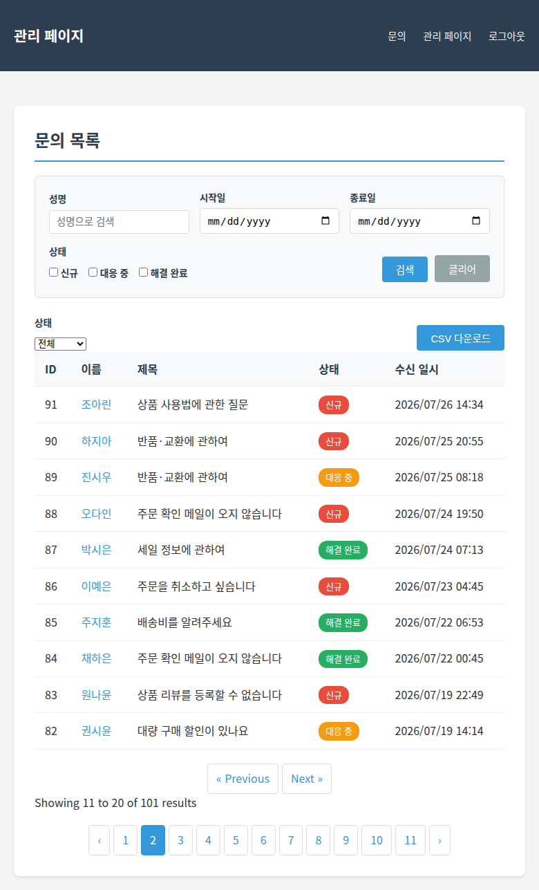

---

#### BT-12-4 검색 조건 유지

| 항목 | 내용 |
|------|------|
| 조작 순서 | 검색 실행 후 페이지네이션으로 2페이지로 이동한다 |
| 기대 결과 | 검색 조건이 유지된 상태로 2페이지가 표시된다 |
| 결과 | OK |
| 비고 | 상태='신규' 조건으로 검색(총 39건) 후 2페이지 링크에 `status[0]=신규&page=2`가 그대로 유지되어 있고, 실제 이동 시에도 10건 모두 '신규' 상태였음을 확인 |

**스크린숏:**

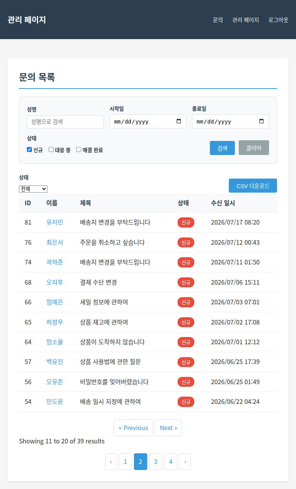

---

### BT-13 검색·필터

#### BT-13-1 이름으로 검색

| 항목 | 내용 |
|------|------|
| 조작 순서 | 이름란에 '민준'을 입력해 검색한다 |
| 기대 결과 | 이름에 '민준'이 들어간 문의만 표시된다 |
| 결과 | OK |
| 비고 | '민준' 검색 시 나민준(ID40)·장민준(ID23)·최민준(ID16) 3건만 표시됨 |

**스크린숏:**

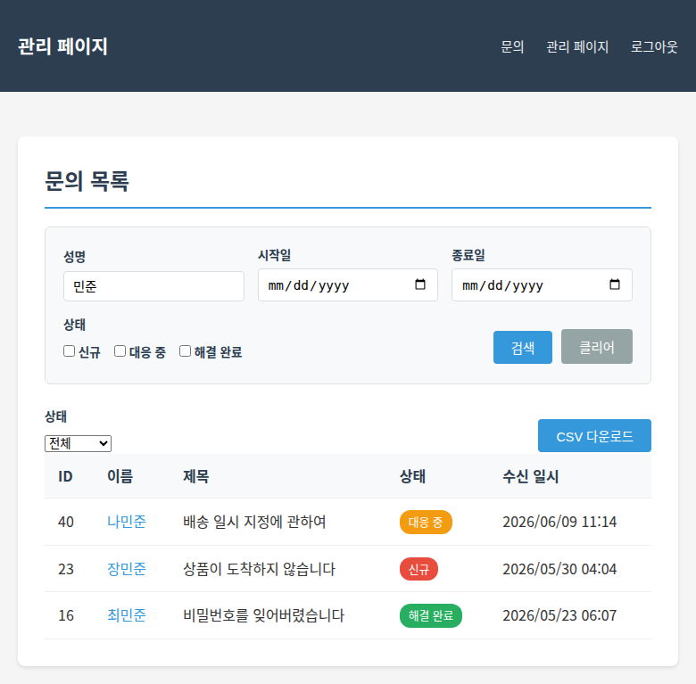

---

#### BT-13-2 이름 부분 일치

| 항목 | 내용 |
|------|------|
| 조작 순서 | 이름란에 '민'을 입력해 검색한다 |
| 기대 결과 | 이름에 '민'이 들어간 문의가 모두 표시된다 |
| 결과 | OK |
| 비고 | '민' 검색 시 황지민·윤민재·유지민·구지민·민도윤·나민준·장민준·최민준·민유준·정지민·신민재 11건이 모두 표시됨(성/이름 어느 위치든 부분 일치 확인) |

**스크린숏:**

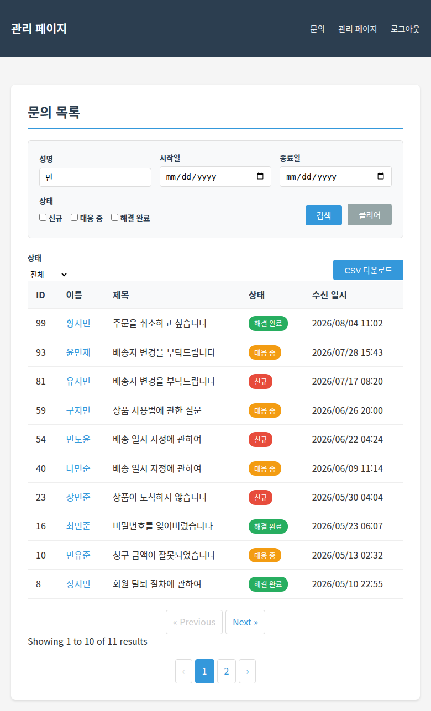

---

#### BT-13-3 날짜(시작일)로 필터링

| 항목 | 내용 |
|------|------|
| 조작 순서 | 시작일을 지정해 검색한다 |
| 기대 결과 | 지정일 이후의 문의만 표시된다 |
| 결과 | OK |
| 비고 | 시작일 2026-07-01 지정 시 표시된 10건의 수신 일시를 JS로 전수 확인한 결과 모두 2026/07/01 이후였음 |

**스크린숏:**

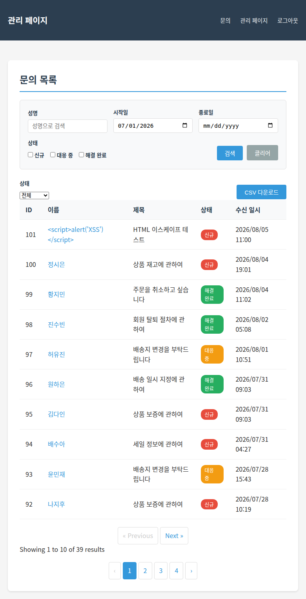

---

#### BT-13-4 날짜(종료일)로 필터링

| 항목 | 내용 |
|------|------|
| 조작 순서 | 종료일을 지정해 검색한다 |
| 기대 결과 | 지정일 이전의 문의만 표시된다 |
| 결과 | OK |
| 비고 | 종료일 2026-06-01 지정 시 표시된 10건 모두 2026/06/01 이전이었음을 확인 |

**스크린숏:**

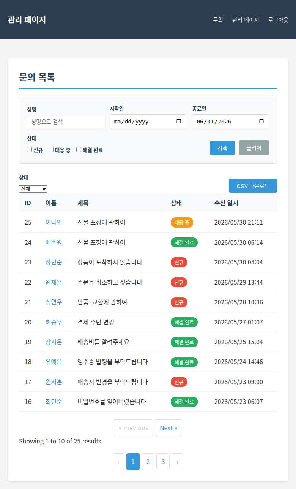

---

#### BT-13-5 날짜 범위로 필터링

| 항목 | 내용 |
|------|------|
| 조작 순서 | 시작일과 종료일을 지정해 검색한다 |
| 기대 결과 | 지정 기간 내의 문의만 표시된다 |
| 결과 | OK |
| 비고 | 2026-06-01~2026-06-30 지정 시 표시된 10건 모두 해당 기간 내였음을 확인 |

**스크린숏:**

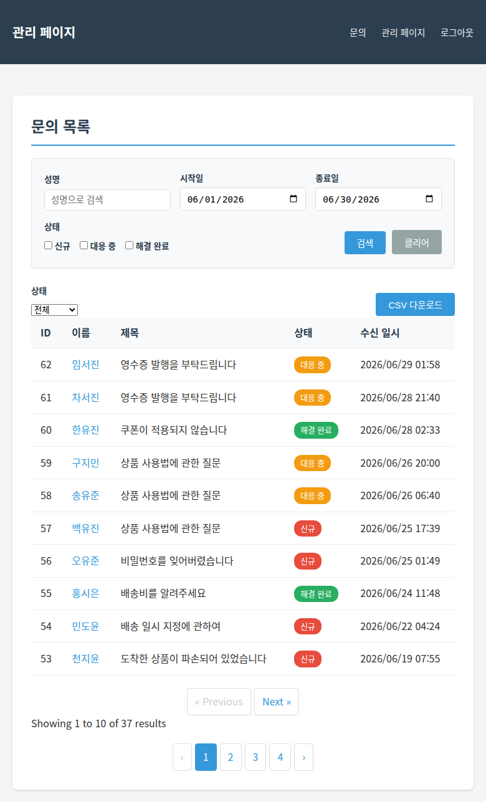

---

#### BT-13-6 상태로 필터링(단일)

| 항목 | 내용 |
|------|------|
| 조작 순서 | '신규' 체크박스만 체크해 검색한다 |
| 기대 결과 | 상태가 '신규'인 문의만 표시된다 |
| 결과 | OK |
| 비고 | '신규' 단일 체크 후 검색 시 표시된 10건의 상태를 전수 확인한 결과 모두 '신규'였음 |

**스크린숏:**

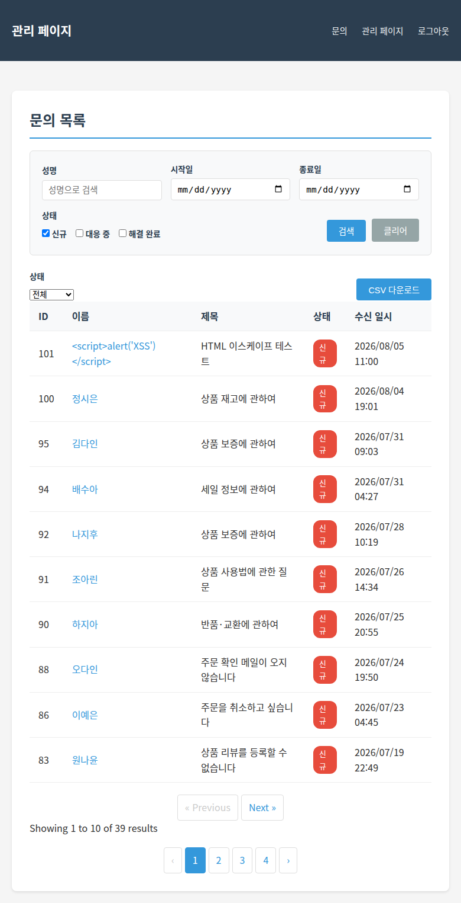

---

#### BT-13-7 상태로 필터링(복수)

| 항목 | 내용 |
|------|------|
| 조작 순서 | '신규'와 '대응 중'을 체크해 검색한다 |
| 기대 결과 | 상태가 '신규' 또는 '대응 중'인 문의가 표시된다 |
| 결과 | OK |
| 비고 | 신규+대응 중 복수 체크 시 표시된 10건이 모두 두 상태 중 하나였고 '해결 완료'는 없었음을 확인 |

**스크린숏:**

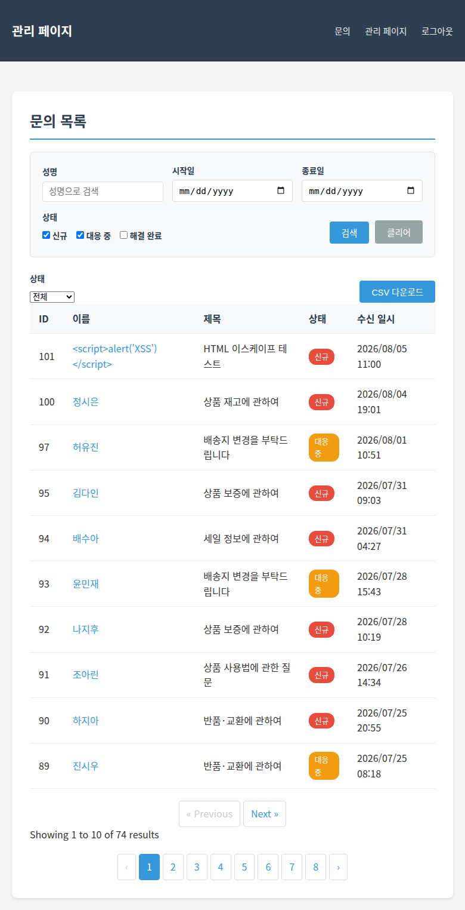

---

#### BT-13-8 복합 검색

| 항목 | 내용 |
|------|------|
| 조작 순서 | 이름·날짜·상태를 조합해 검색한다 |
| 기대 결과 | 모든 조건을 만족하는 문의만 표시된다 |
| 결과 | OK |
| 비고 | 이름='원', 기간=2026-05-01~2026-08-05, 상태='해결 완료' 조합 검색 시 원하은(ID96)·배주원(ID24) 2건만 표시되어 모든 조건이 AND로 정확히 적용됨을 사전 DB 조회 결과와 대조하여 확인 |

**스크린숏:**

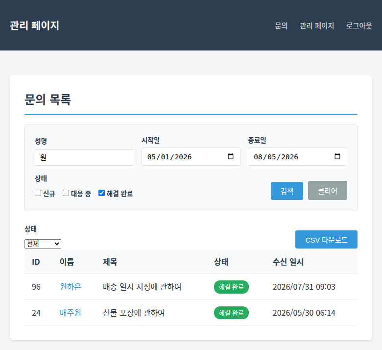

---

#### BT-13-9 검색 조건 클리어

| 항목 | 내용 |
|------|------|
| 조작 순서 | 이름란에 '민'을 입력해 검색한 뒤 '클리어' 버튼을 누른다 |
| 기대 결과 | 검색 조건이 초기화되고 전체가 표시된다 |
| 결과 | OK |
| 비고 | '민' 검색(11건) 후 '클리어' 클릭 시 `/admin/contacts`(쿼리 파라미터 없음)로 이동, 이름·날짜·상태 입력란이 모두 초기화되고 전체 101건이 다시 표시됨을 확인 |

**스크린숏:**

---

#### BT-13-10 해당 없는 검색

| 항목 | 내용 |
|------|------|
| 조작 순서 | 존재하지 않는 이름으로 검색한다 |
| 기대 결과 | 검색 결과가 0건임이 표시된다(오류가 나지 않는다) |
| 결과 | OK |
| 비고 | 존재하지 않는 이름("존재하지않는이름XYZ123")으로 검색 시 오류 없이 "문의가 아직 없습니다." 안내가 표시됨 |

**스크린숏:**

---

### BT-14 문의 상세

#### BT-14-1 상세 화면 표시

| 항목 | 내용 |
|------|------|
| 조작 순서 | 목록에서 임의의 문의를 클릭한다 |
| 기대 결과 | 상세 화면이 표시된다 |
| 결과 | OK |
| 비고 | 목록에서 이름 클릭 시 상세 화면(`/admin/contacts/100`)이 정상 표시됨 |

**스크린숏:**

---

#### BT-14-2 표시 항목 확인

| 항목 | 내용 |
|------|------|
| 조작 순서 | 상세 화면의 표시 항목을 확인한다 |
| 기대 결과 | ID·이름·이메일 주소·제목·본문·수신 일시가 표시된다 |
| 결과 | OK |
| 비고 | ID/이름/이메일 주소/제목/본문/수신 일시 6개 항목이 모두 표시됨 |

**스크린숏:**

---

#### BT-14-3 본문 줄바꿈 표시

| 항목 | 내용 |
|------|------|
| 조작 순서 | 줄바꿈이 있는 본문의 문의를 표시한다 |
| 기대 결과 | 줄바꿈이 반영된 상태로 표시된다 |
| 결과 | OK |
| 비고 | BT-6에서 제출한 3줄 본문(ID 101)의 상세 화면에서 `dd` innerHTML 확인 결과 줄바꿈마다 ` ` 태그가 삽입되어 있음을 확인 |

**스크린숏:**

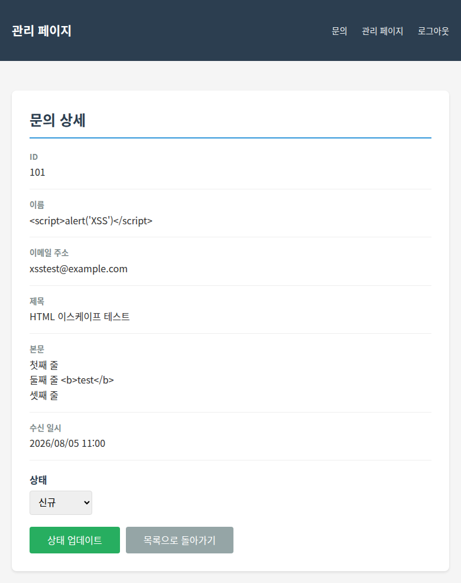

---

#### BT-14-4 HTML 이스케이프

| 항목 | 내용 |
|------|------|
| 조작 순서 | HTML 태그가 있는 본문의 문의를 표시한다 |
| 기대 결과 | HTML 태그가 이스케이프되어 스크립트가 실행되지 않는다 |
| 결과 | OK |
| 비고 | ID 101 상세에서 이름의 `<script>` 태그가 `&lt;script&gt;`로, 본문의 `<b>` 태그가 `&lt;b&gt;`로 각각 이스케이프되어 렌더링됨을 `dd` innerHTML로 확인(스크립트 미실행, 굵게 표시되지 않고 텍스트 그대로 노출) |

**스크린숏:**

---

#### BT-14-5 상태 드롭다운

| 항목 | 내용 |
|------|------|
| 조작 순서 | 상세 화면의 상태란을 확인한다 |
| 기대 결과 | 드롭다운에 '신규' '대응 중' '해결 완료'가 표시된다 |
| 결과 | OK |
| 비고 | 드롭다운 옵션 3개(신규/대응 중/해결 완료)가 모두 존재함을 확인 |

**스크린숏:**

---

#### BT-14-6 현재 상태가 선택된 상태

| 항목 | 내용 |
|------|------|
| 조작 순서 | 상태가 '대응 중'인 문의의 상세를 연다 |
| 기대 결과 | 드롭다운에서 '대응 중'이 선택된 상태다 |
| 결과 | OK |
| 비고 | 상태='대응 중'인 레코드(ID 97)의 상세에서 드롭다운이 정확히 '대응 중'으로 선택되어 있음을 확인 |

**스크린숏:**

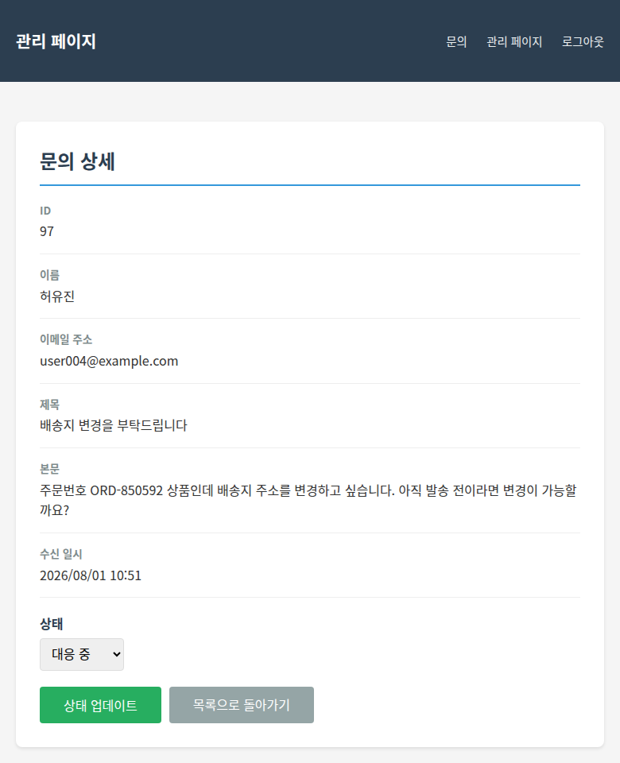

---

#### BT-14-7 '목록으로 돌아가기' 링크

| 항목 | 내용 |
|------|------|
| 조작 순서 | '목록으로 돌아가기' 링크를 클릭한다 |
| 기대 결과 | 문의 목록 화면으로 이동한다 |
| 결과 | OK |
| 비고 | 클릭 시 `/admin/contacts` 목록 화면으로 정상 이동 |

**스크린숏:**

---

#### BT-14-8 존재하지 않는 ID 접근

| 항목 | 내용 |
|------|------|
| 조작 순서 | 브라우저로 존재하지 않는 ID(예: `/admin/contacts/99999`)에 접근한다 |
| 기대 결과 | 404 오류가 반환된다 |
| 결과 | OK |
| 비고 | `/admin/contacts/99999` 접근 시 HTTP 404 Not Found가 정상 반환됨 |

**스크린숏:**

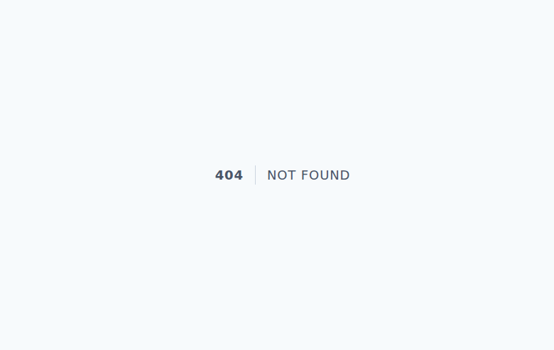

---

### BT-15 상태 업데이트

> 실제 조작 순서는 레코드 ID 97(제출 당시 '대응 중')을 이용해 대응 중→해결 완료(BT-15-2)→신규(BT-15-3)→대응 중(BT-15-1) 순으로 진행했습니다. 3가지 전환 모두 UI에서 실제로 실행하여 각각의 동작을 개별 확인했습니다.

#### BT-15-1 '신규'→'대응 중'으로 변경

| 항목 | 내용 |
|------|------|
| 조작 순서 | 상태를 '대응 중'으로 바꾸고 업데이트 버튼을 누른다 |
| 기대 결과 | 상태가 '대응 중'으로 바뀌고 성공 메시지가 표시된다 |
| 결과 | OK |
| 비고 | '신규' 상태였던 레코드(ID 97)를 '대응 중'으로 변경, 드롭다운도 '대응 중'으로 갱신되고 성공 메시지가 표시됨 |

**스크린숏:**

---

#### BT-15-2 '대응 중'→'해결 완료'로 변경

| 항목 | 내용 |
|------|------|
| 조작 순서 | 상태를 '해결 완료'로 바꾸고 업데이트 버튼을 누른다 |
| 기대 결과 | 상태가 '해결 완료'로 바뀌고 성공 메시지가 표시된다 |
| 결과 | OK |
| 비고 | '대응 중' 상태였던 레코드(ID 97)를 '해결 완료'로 변경, 정상 반영됨 |

**스크린숏:**

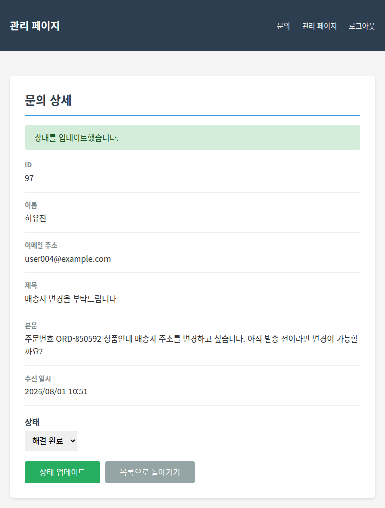

---

#### BT-15-3 '해결 완료'→'신규'로 변경

| 항목 | 내용 |
|------|------|
| 조작 순서 | 상태를 '신규'로 바꾸고 업데이트 버튼을 누른다 |
| 기대 결과 | 상태가 '신규'로 바뀌고 성공 메시지가 표시된다 |
| 결과 | OK |
| 비고 | '해결 완료' 상태였던 레코드(ID 97)를 '신규'로 변경, 정상 반영됨(3단계 순환 전환 모두 정상 동작 확인) |

**스크린숏:**

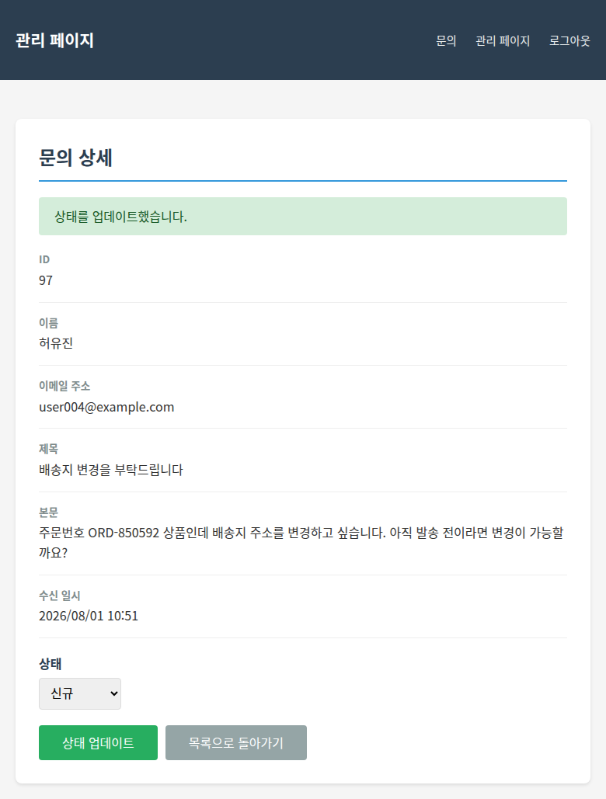

---

#### BT-15-4 성공 메시지 표시

| 항목 | 내용 |
|------|------|
| 조작 순서 | 상태를 업데이트한다 |
| 기대 결과 | '상태를 업데이트했습니다.'가 표시된다 |
| 결과 | OK |
| 비고 | BT-15-1~3의 3회 업데이트 모두에서 동일한 문구 "상태를 업데이트했습니다."가 정상 표시됨을 확인 |

**스크린숏:**

---

#### BT-15-5 목록 반영 확인

| 항목 | 내용 |
|------|------|
| 조작 순서 | 상태 업데이트 후 목록 화면에서 확인한다 |
| 기대 결과 | 목록 화면에도 업데이트된 상태가 반영된다 |
| 결과 | OK |
| 비고 | 상세에서 최종적으로 '대응 중'으로 변경 후 목록 화면(ID 97 행)에서도 '대응 중'으로 정확히 반영되어 있음을 JS로 확인 |

**스크린숏:**

---

### BT-16 로그아웃

#### BT-16-1 로그아웃 실행

| 항목 | 내용 |
|------|------|
| 조작 순서 | 헤더의 로그아웃 버튼을 누른다 |
| 기대 결과 | 로그인 화면으로 리다이렉트된다 |
| 결과 | OK |
| 비고 | 클릭 시 `/admin/login`으로 정상 리다이렉트됨 |

**스크린숏:**

---

#### BT-16-2 로그아웃 후 세션

| 항목 | 내용 |
|------|------|
| 조작 순서 | 로그아웃 후 관리 화면 URL에 직접 접근한다 |
| 기대 결과 | 로그인 화면으로 리다이렉트된다 |
| 결과 | OK |
| 비고 | 로그아웃 후 `/admin/contacts` 직접 접근 시 세션이 없어 로그인 화면으로 정상 리다이렉트됨 |

**스크린숏:**

---

## 종합 소견

| 항목 | 내용 |
|------|------|
| 종합 판정 | 조건부 합격 |
| 특기 사항 | 실제 조작 검증 결과 74개 항목 중 71개가 정상(OK), 3개가 NG였음. 관리 페이지 쪽(로그인/접근 제어/목록/페이지네이션/검색/상세/상태 변경/로그아웃) 44개 항목은 전부 OK로, 관리자 기능은 안정적으로 동작함. NG 3건은 모두 치명적 기능 결함이 아니라 UX/브라우저 캐시 이슈임: (1)(2) 이메일 형식 오류(BT-3-1, BT-3-2) 시 `<input type="email">`의 브라우저 네이티브 HTML5 검증이 폼 제출 자체를 막아 서버까지 요청이 도달하지 않고, 따라서 서버가 준비한 한국어 오류 메시지가 표시되지 않음(이메일 자체는 결국 거부되므로 데이터 무결성 문제는 아님). (3) 전송 완료 후 뒤로 가기(BT-7-3) 시 브라우저 bfcache가 서버 재요청을 생략하고 이전 확인 화면을 그대로 재렌더링함(세션 자체는 정상적으로 비워져 있음이 확인되었으나, bfcache로 인해 사용자 입장에서는 화면이 재표시되는 것처럼 보임). 테스트 과정에서 XSS·줄바꿈 이스케이프 검증용 문의(ID 101)를 실제로 제출하여 총 문의 건수가 100건에서 101건으로 늘었으며, 이는 이후 목록·페이지네이션·검색 결과 수치에도 반영되어 있음. |
| 다음 대응 사항 | 1) 이메일 입력란에 `novalidate` 속성을 추가하거나, 서버 측 형식 검증 메시지를 우선적으로 노출하도록 개선하여 BT-3-1/BT-3-2를 해결할 것(현재는 브라우저 native 검증 때문에 서버의 한국어 오류 메시지를 사용자가 볼 수 없음). 2) 확인 화면(`/contact/confirm`) 응답에 `Cache-Control: no-store` 헤더를 추가하여 전송 완료 후 뒤로 가기 시 bfcache로 확인 화면이 재표시되지 않도록 개선할 것(BT-7-3). |

---

이상
