# 브라우저 테스트 보고서

## 기본 정보

| 항목 | 내용 |
|------|------|
| 프로젝트명 | 문의 폼 |
| 테스트 실시일 | 2026년　월　일 |
| 테스트 실시자 | |
| 테스트 환경 URL | |
| 브라우저 | Google Chrome |
| 브라우저 버전 | |
| OS | |

---

## 테스트 결과 요약

| 카테고리 | 총수 | OK | NG | 미실시 |
|---------|------|----|----|--------|
| 1. 문의 폼 쪽 | 30 | | | |
| 2. 관리 페이지 쪽 | 44 | | | |
| **합계** | **74** | | | |

---

## 1. 문의 폼 쪽

### BT-1 입력 화면 표시 확인

#### BT-1-1 폼 표시

| 항목 | 내용 |
|------|------|
| 조작 순서 | `/`에 접근한다 |
| 기대 결과 | 입력 폼(이름·이메일 주소·제목·본문)이 표시된다 |
| 결과 | OK / NG |
| 비고 | |

**스크린숏:**

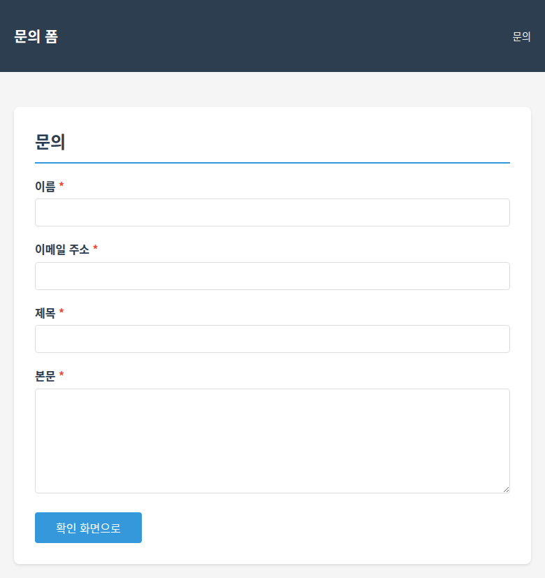

---

#### BT-1-2 필수 표시

| 항목 | 내용 |
|------|------|
| 조작 순서 | 입력 화면을 확인한다 |
| 기대 결과 | 각 항목에 필수 표시(*)가 있다 |
| 결과 | OK / NG |
| 비고 | |

**스크린숏:**

---

### BT-2 유효성 검사(필수 검사)

#### BT-2-1 전체 항목 미입력

| 항목 | 내용 |
|------|------|
| 조작 순서 | 모두 빈칸인 채로 '확인 화면으로'를 누른다 |
| 기대 결과 | 전체 항목에 오류 메시지가 표시된다 |
| 결과 | OK / NG |
| 비고 | |

**스크린숏:**

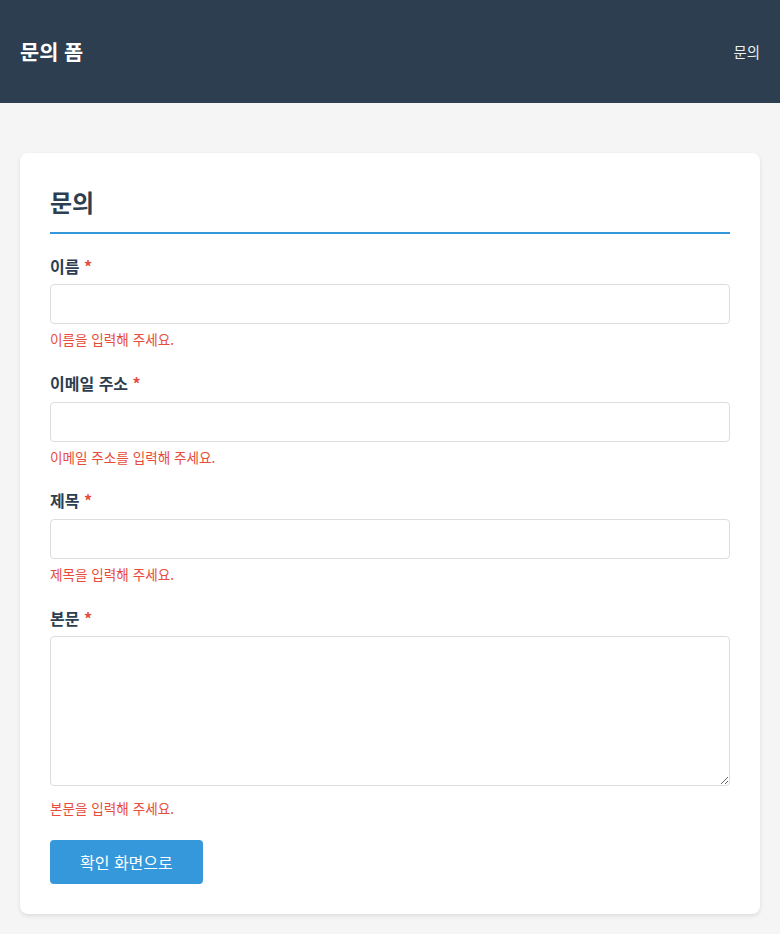

---

#### BT-2-2 이름 미입력

| 항목 | 내용 |
|------|------|
| 조작 순서 | 이름만 빈칸으로 두고 나머지를 입력해 전송한다 |
| 기대 결과 | '이름을 입력해 주세요.'가 표시된다 |
| 결과 | OK / NG |
| 비고 | |

**스크린숏:**

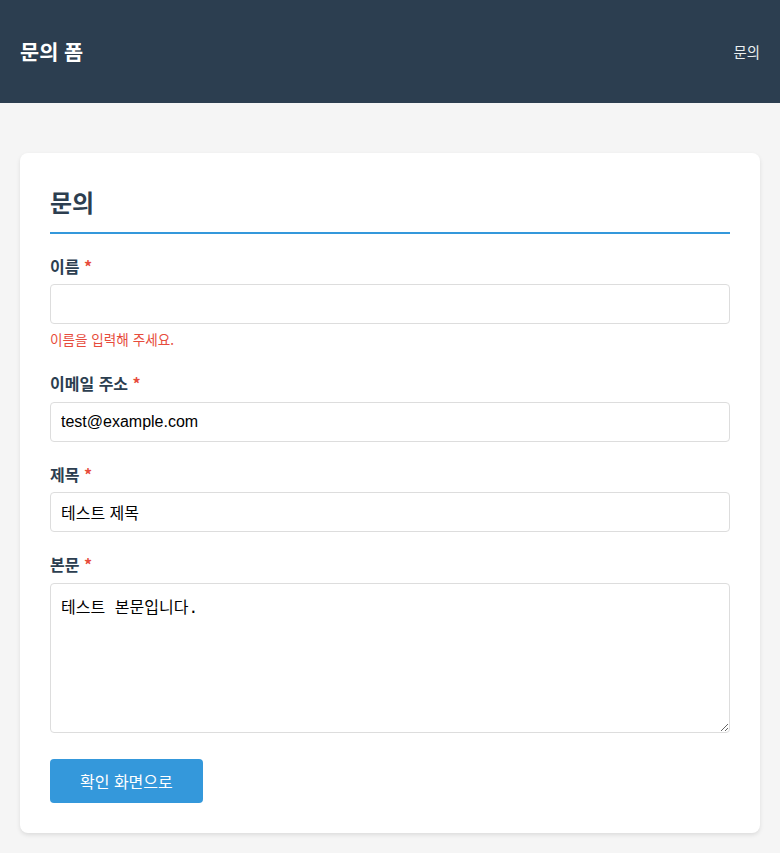

---

#### BT-2-3 이메일 주소 미입력

| 항목 | 내용 |
|------|------|
| 조작 순서 | 이메일 주소만 빈칸으로 두고 나머지를 입력해 전송한다 |
| 기대 결과 | '이메일 주소를 입력해 주세요.'가 표시된다 |
| 결과 | OK / NG |
| 비고 | |

**스크린숏:**

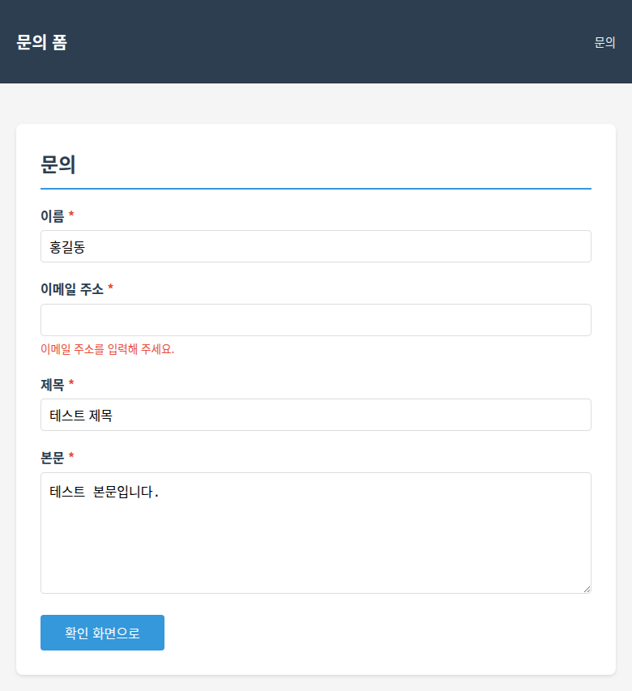

---

#### BT-2-4 제목 미입력

| 항목 | 내용 |
|------|------|
| 조작 순서 | 제목만 빈칸으로 두고 나머지를 입력해 전송한다 |
| 기대 결과 | '제목을 입력해 주세요.'가 표시된다 |
| 결과 | OK / NG |
| 비고 | |

**스크린숏:**

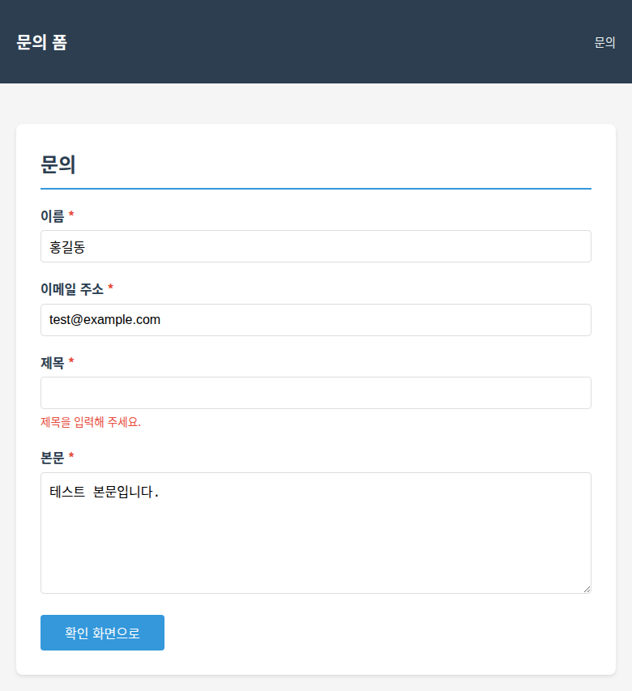

---

#### BT-2-5 본문 미입력

| 항목 | 내용 |
|------|------|
| 조작 순서 | 본문만 빈칸으로 두고 나머지를 입력해 전송한다 |
| 기대 결과 | '본문을 입력해 주세요.'가 표시된다 |
| 결과 | OK / NG |
| 비고 | |

**스크린숏:**

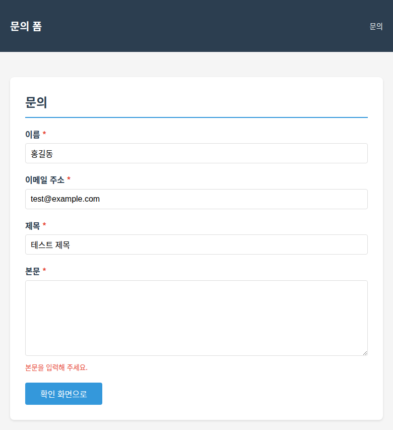

---

### BT-3 유효성 검사(형식 검사)

#### BT-3-1 이메일 주소 형식 부정

| 항목 | 내용 |
|------|------|
| 조작 순서 | 이메일 주소에 `abc`를 입력해 전송한다 |
| 기대 결과 | '올바른 이메일 주소 형식으로 입력해 주세요.'가 표시된다 |
| 결과 | OK / NG |
| 비고 | |

**스크린숏:**

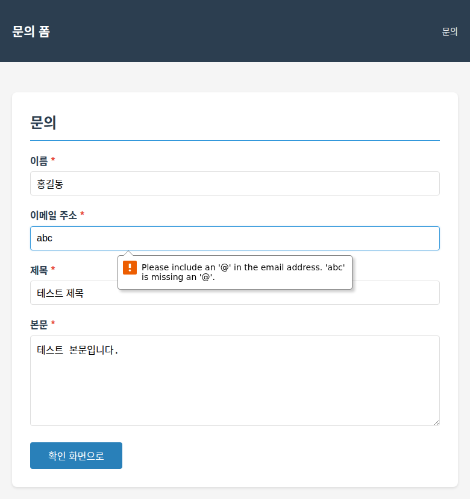

---

#### BT-3-2 이메일 주소 형식 부정(@ 없음)

| 항목 | 내용 |
|------|------|
| 조작 순서 | 이메일 주소에 `test.example.com`을 입력해 전송한다 |
| 기대 결과 | 형식 오류가 표시된다 |
| 결과 | OK / NG |
| 비고 | |

**스크린숏:**

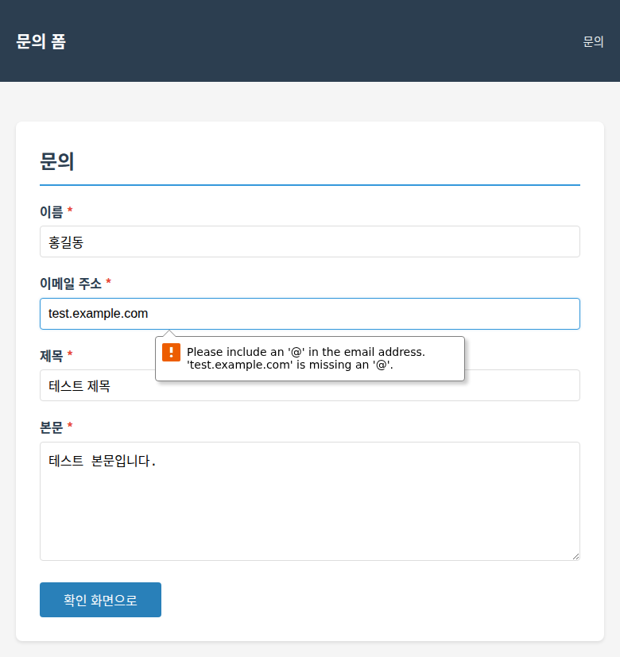

---

#### BT-3-3 이메일 주소 정상 형식

| 항목 | 내용 |
|------|------|
| 조작 순서 | 이메일 주소에 `test@example.com`을 입력해 전송한다 |
| 기대 결과 | 이메일 주소 유효성 검사 오류가 나지 않는다 |
| 결과 | OK / NG |
| 비고 | |

**스크린숏:**

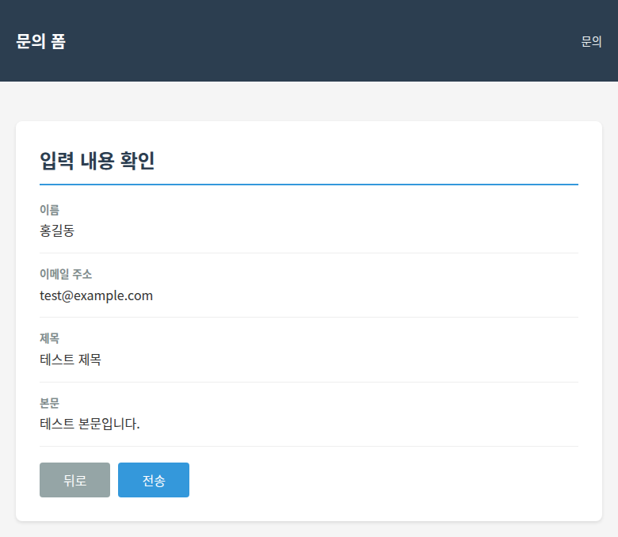

---

### BT-4 유효성 검사(글자 수 검사)

#### BT-4-1 이름 255자

| 항목 | 내용 |
|------|------|
| 조작 순서 | 이름에 255자를 입력해 전송한다 |
| 기대 결과 | 오류 없이 확인 화면으로 이동한다 |
| 결과 | OK / NG |
| 비고 | |

**스크린숏:**

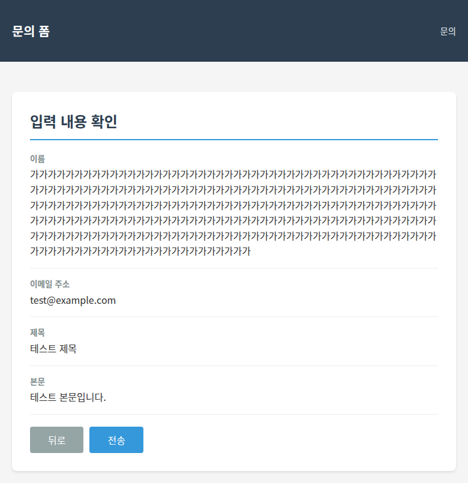

---

#### BT-4-2 이름 256자

| 항목 | 내용 |
|------|------|
| 조작 순서 | 이름에 256자를 입력해 전송한다 |
| 기대 결과 | '이름은 255자 이내로 입력해 주세요.'가 표시된다 |
| 결과 | OK / NG |
| 비고 | |

**스크린숏:**

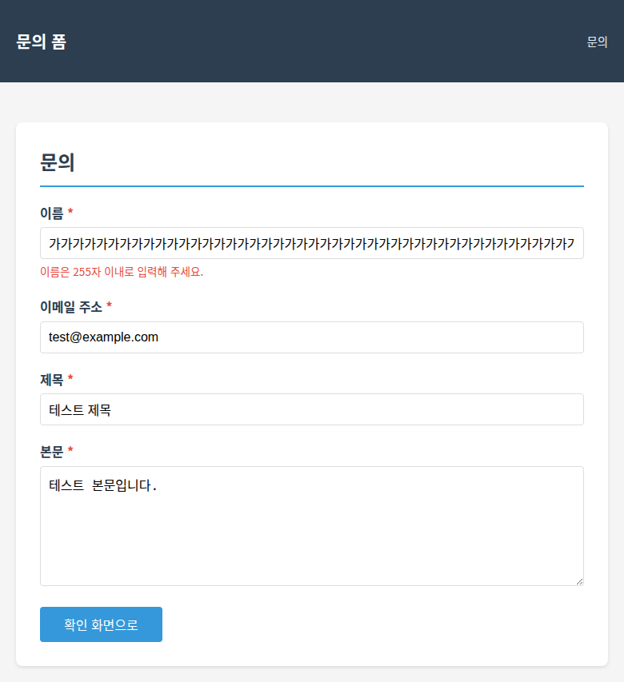

---

#### BT-4-3 이메일 주소 255자

| 항목 | 내용 |
|------|------|
| 조작 순서 | 이메일 주소에 255자를 입력해 전송한다 |
| 기대 결과 | 오류 없이 확인 화면으로 이동한다 |
| 결과 | OK / NG |
| 비고 | |

**스크린숏:**

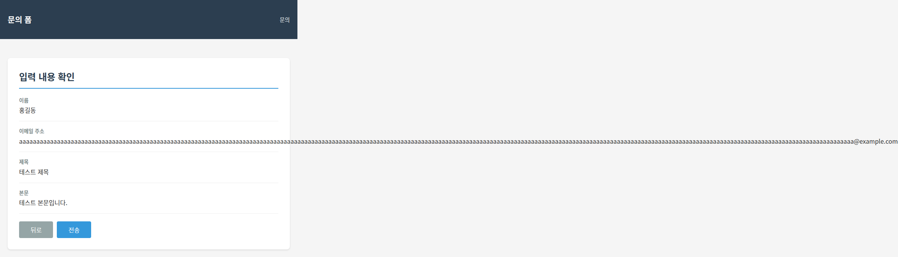

---

#### BT-4-4 이메일 주소 256자

| 항목 | 내용 |
|------|------|
| 조작 순서 | 이메일 주소에 256자를 입력해 전송한다 |
| 기대 결과 | '이메일 주소는 255자 이내로 입력해 주세요.'가 표시된다 |
| 결과 | OK / NG |
| 비고 | |

**스크린숏:**

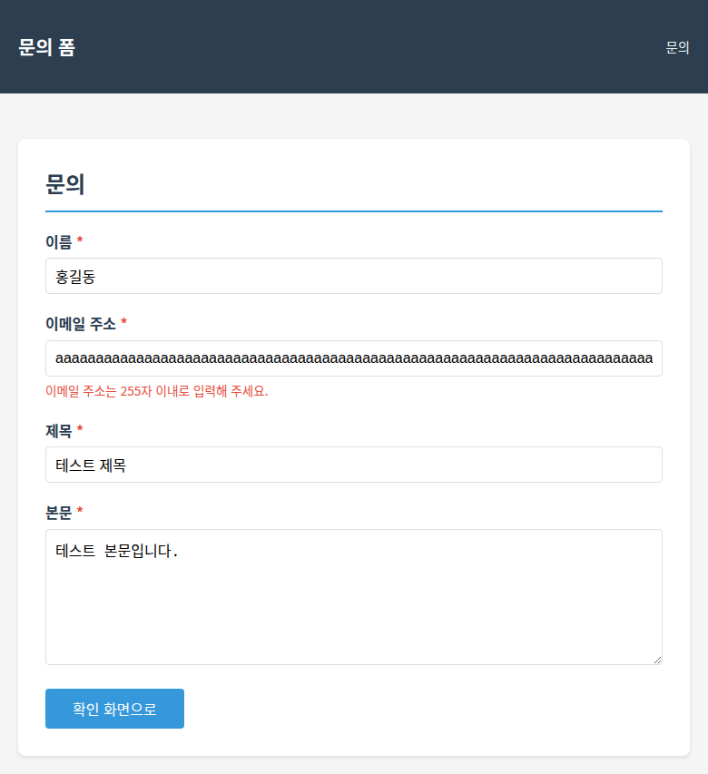

---

#### BT-4-5 제목 255자

| 항목 | 내용 |
|------|------|
| 조작 순서 | 제목에 255자를 입력해 전송한다 |
| 기대 결과 | 오류 없이 확인 화면으로 이동한다 |
| 결과 | OK / NG |
| 비고 | |

**스크린숏:**

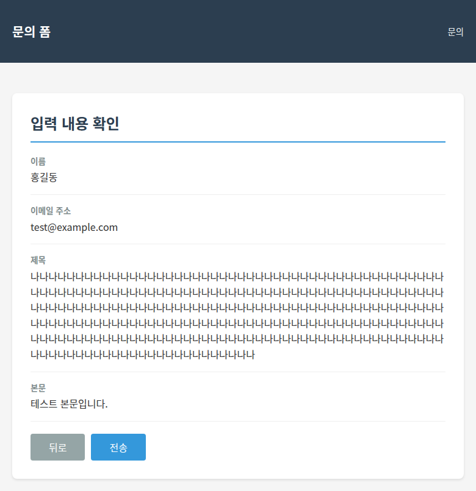

---

#### BT-4-6 제목 256자

| 항목 | 내용 |
|------|------|
| 조작 순서 | 제목에 256자를 입력해 전송한다 |
| 기대 결과 | '제목은 255자 이내로 입력해 주세요.'가 표시된다 |
| 결과 | OK / NG |
| 비고 | |

**스크린숏:**

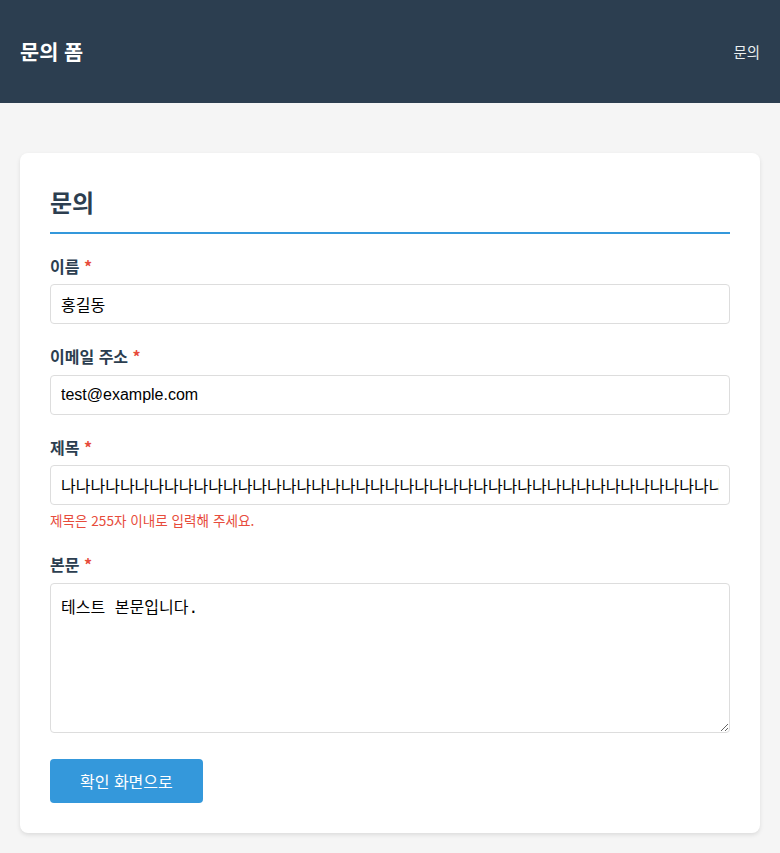

---

### BT-5 유효성 검사(입력값 복원)

#### BT-5-1 오류 뒤 입력값 복원

| 항목 | 내용 |
|------|------|
| 조작 순서 | 이름만 빈칸으로 전송한다 |
| 기대 결과 | 이름 외의 입력값이 입력란에 복원되어 있다 |
| 결과 | OK / NG |
| 비고 | |

**스크린숏:**

---

### BT-6 확인 화면

#### BT-6-1 확인 화면 표시

| 항목 | 내용 |
|------|------|
| 조작 순서 | 전체 항목을 올바르게 입력하고 '확인 화면으로'를 누른다 |
| 기대 결과 | 확인 화면에 입력 내용이 표시된다 |
| 결과 | OK / NG |
| 비고 | |

**스크린숏:**

---

#### BT-6-2 이름 표시

| 항목 | 내용 |
|------|------|
| 조작 순서 | 확인 화면에서 이름 표시를 확인한다 |
| 기대 결과 | 입력한 이름이 올바르게 표시된다 |
| 결과 | OK / NG |
| 비고 | |

**스크린숏:**

---

#### BT-6-3 이메일 주소 표시

| 항목 | 내용 |
|------|------|
| 조작 순서 | 확인 화면에서 이메일 주소 표시를 확인한다 |
| 기대 결과 | 입력한 이메일 주소가 올바르게 표시된다 |
| 결과 | OK / NG |
| 비고 | |

**스크린숏:**

---

#### BT-6-4 제목 표시

| 항목 | 내용 |
|------|------|
| 조작 순서 | 확인 화면에서 제목 표시를 확인한다 |
| 기대 결과 | 입력한 제목이 올바르게 표시된다 |
| 결과 | OK / NG |
| 비고 | |

**스크린숏:**

---

#### BT-6-5 본문 표시

| 항목 | 내용 |
|------|------|
| 조작 순서 | 확인 화면에서 본문 표시를 확인한다 |
| 기대 결과 | 입력한 본문이 올바르게 표시된다 |
| 결과 | OK / NG |
| 비고 | |

**스크린숏:**

---

#### BT-6-6 본문 줄바꿈 유지

| 항목 | 내용 |
|------|------|
| 조작 순서 | 본문에 줄바꿈이 있는 문장을 입력해 확인 화면을 표시한다 |
| 기대 결과 | 줄바꿈이 반영된 상태로 표시된다 |
| 결과 | OK / NG |
| 비고 | |

**스크린숏:**

---

#### BT-6-7 HTML 이스케이프

| 항목 | 내용 |
|------|------|
| 조작 순서 | 이름에 ``를 입력해 확인 화면을 표시한다 |
| 기대 결과 | HTML 태그가 이스케이프되어 스크립트가 실행되지 않는다 |
| 결과 | OK / NG |
| 비고 | |

**스크린숏:**

---

#### BT-6-8 '뒤로' 버튼

| 항목 | 내용 |
|------|------|
| 조작 순서 | 확인 화면에서 '뒤로' 버튼을 누른다 |
| 기대 결과 | 입력 화면으로 돌아가고 입력 내용이 복원되어 있다 |
| 결과 | OK / NG |
| 비고 | |

**스크린숏:**

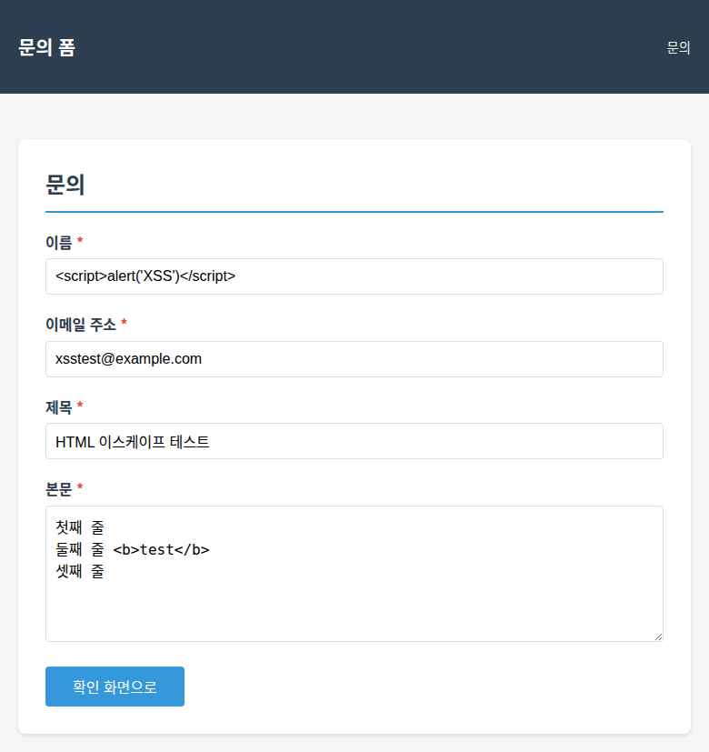

---

#### BT-6-9 '전송' 버튼

| 항목 | 내용 |
|------|------|
| 조작 순서 | 확인 화면에서 '전송' 버튼을 누른다 |
| 기대 결과 | 전송 처리가 실행되고 완료 화면으로 리다이렉트된다 |
| 결과 | OK / NG |
| 비고 | |

**스크린숏:**

---

### BT-7 전송 처리·완료 화면

#### BT-7-1 완료 화면 표시

| 항목 | 내용 |
|------|------|
| 조작 순서 | 확인 화면에서 전송한다 |
| 기대 결과 | '문의해 주셔서 감사합니다'가 표시된다 |
| 결과 | OK / NG |
| 비고 | |

**스크린숏:**

---

#### BT-7-2 폼 링크

| 항목 | 내용 |
|------|------|
| 조작 순서 | 완료 화면을 확인한다 |
| 기대 결과 | 문의 폼 링크가 표시된다 |
| 결과 | OK / NG |
| 비고 | |

**스크린숏:**

---

#### BT-7-3 세션 비우기

| 항목 | 내용 |
|------|------|
| 조작 순서 | 전송 완료 후 브라우저의 뒤로 가기로 확인 화면에 돌아가려 한다 |
| 기대 결과 | 세션 데이터가 비워져 확인 화면이 다시 표시되지 않는다 |
| 결과 | OK / NG |
| 비고 | |

**스크린숏:**

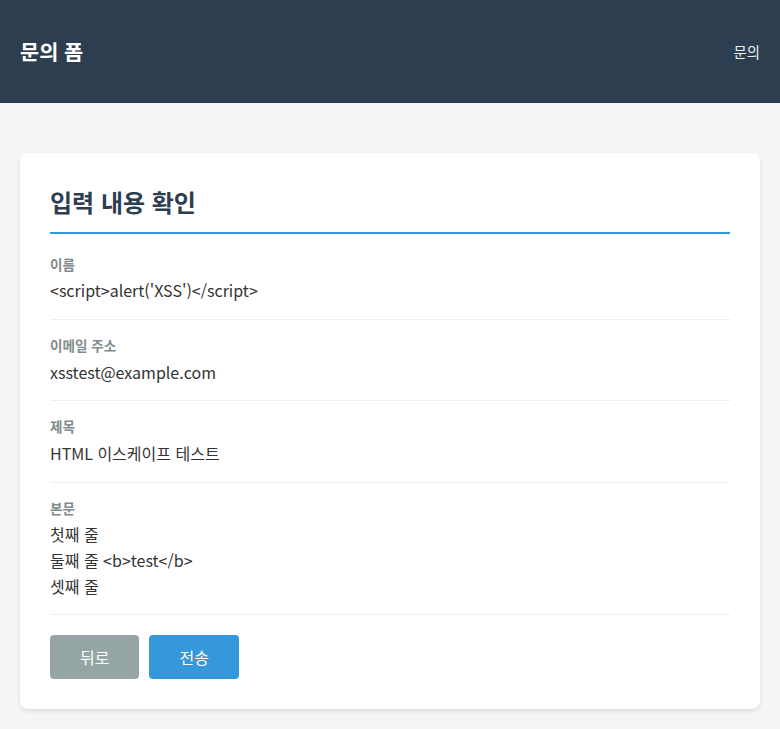

---

### BT-8 부정 접근

#### BT-8-1 완료 화면 직접 접근

| 항목 | 내용 |
|------|------|
| 조작 순서 | 브라우저로 `/contact/thanks`에 직접 접근한다 |
| 기대 결과 | 완료 화면이 표시된다(오류가 나지 않는다) |
| 결과 | OK / NG |
| 비고 | |

**스크린숏:**

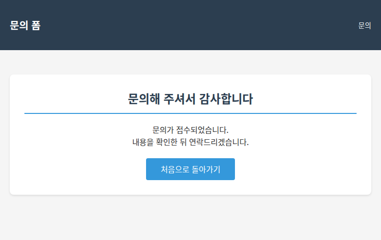

---

## 2. 관리 페이지 쪽

### BT-9 로그인 화면

#### BT-9-1 로그인 화면 표시

| 항목 | 내용 |
|------|------|
| 조작 순서 | `/admin/login`에 접근한다 |
| 기대 결과 | 비밀번호 입력란과 로그인 버튼이 표시된다 |
| 결과 | OK / NG |
| 비고 | |

**스크린숏:**

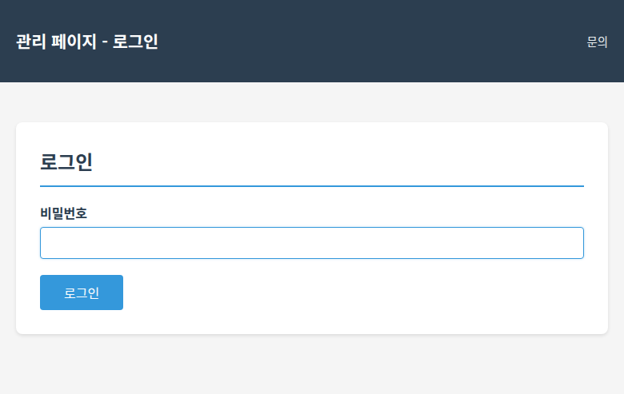

---

#### BT-9-2 올바른 비밀번호로 로그인

| 항목 | 내용 |
|------|------|
| 조작 순서 | 올바른 비밀번호를 입력해 로그인한다 |
| 기대 결과 | 관리 화면(문의 목록)으로 리다이렉트된다 |
| 결과 | OK / NG |
| 비고 | |

**스크린숏:**

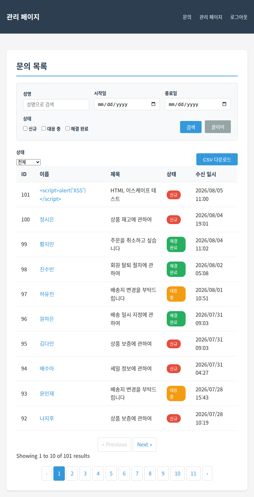

---

#### BT-9-3 잘못된 비밀번호로 로그인

| 항목 | 내용 |
|------|------|
| 조작 순서 | 잘못된 비밀번호를 입력해 로그인한다 |
| 기대 결과 | 오류 메시지가 표시되고 로그인 화면으로 돌아간다 |
| 결과 | OK / NG |
| 비고 | |

**스크린숏:**

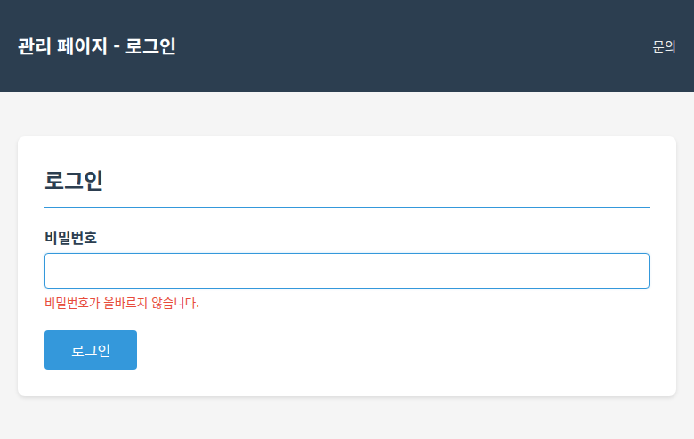

---

#### BT-9-4 비밀번호 미입력으로 로그인

| 항목 | 내용 |
|------|------|
| 조작 순서 | 비밀번호를 빈칸인 채로 전송한다 |
| 기대 결과 | 유효성 검사 오류가 표시된다 |
| 결과 | OK / NG |
| 비고 | |

**스크린숏:**

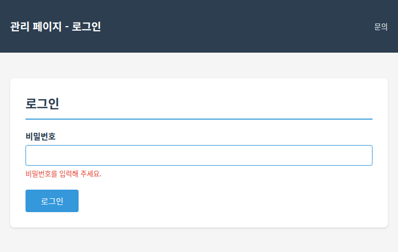

---

### BT-10 인증·접근 제어

#### BT-10-1 미로그인 상태로 목록 접근

| 항목 | 내용 |
|------|------|
| 조작 순서 | 로그인하지 않고 `/admin/contacts`에 접근한다 |
| 기대 결과 | 로그인 화면으로 리다이렉트된다 |
| 결과 | OK / NG |
| 비고 | |

**스크린숏:**

---

#### BT-10-2 미로그인 상태로 상세 접근

| 항목 | 내용 |
|------|------|
| 조작 순서 | 로그인하지 않고 `/admin/contacts/1`에 접근한다 |
| 기대 결과 | 로그인 화면으로 리다이렉트된다 |
| 결과 | OK / NG |
| 비고 | |

**스크린숏:**

---

#### BT-10-3 로그아웃

| 항목 | 내용 |
|------|------|
| 조작 순서 | 로그인 후 로그아웃 버튼을 누른다 |
| 기대 결과 | 로그인 화면으로 리다이렉트된다 |
| 결과 | OK / NG |
| 비고 | |

**스크린숏:**

---

#### BT-10-4 로그아웃 후 접근

| 항목 | 내용 |
|------|------|
| 조작 순서 | 로그아웃 후 `/admin/contacts`에 접근한다 |
| 기대 결과 | 로그인 화면으로 리다이렉트된다 |
| 결과 | OK / NG |
| 비고 | |

**스크린숏:**

---

### BT-11 문의 목록 표시

#### BT-11-1 목록 화면 표시

| 항목 | 내용 |
|------|------|
| 조작 순서 | 로그인 후 목록 화면을 연다 |
| 기대 결과 | 문의 목록이 표시된다 |
| 결과 | OK / NG |
| 비고 | |

**스크린숏:**

---

#### BT-11-2 표시 항목 확인

| 항목 | 내용 |
|------|------|
| 조작 순서 | 목록의 표시 항목을 확인한다 |
| 기대 결과 | ID·이름·제목·상태·수신 일시가 표시된다 |
| 결과 | OK / NG |
| 비고 | |

**스크린숏:**

---

#### BT-11-3 상태 배지 색(신규)

| 항목 | 내용 |
|------|------|
| 조작 순서 | 상태가 '신규'인 레코드를 확인한다 |
| 기대 결과 | 빨강 배지로 표시된다 |
| 결과 | OK / NG |
| 비고 | |

**스크린숏:**

---

#### BT-11-4 상태 배지 색(대응 중)

| 항목 | 내용 |
|------|------|
| 조작 순서 | 상태가 '대응 중'인 레코드를 확인한다 |
| 기대 결과 | 주황 배지로 표시된다 |
| 결과 | OK / NG |
| 비고 | |

**스크린숏:**

---

#### BT-11-5 상태 배지 색(해결 완료)

| 항목 | 내용 |
|------|------|
| 조작 순서 | 상태가 '해결 완료'인 레코드를 확인한다 |
| 기대 결과 | 초록 배지로 표시된다 |
| 결과 | OK / NG |
| 비고 | |

**스크린숏:**

---

#### BT-11-6 상세 링크

| 항목 | 내용 |
|------|------|
| 조작 순서 | 목록의 이름을 클릭한다 |
| 기대 결과 | 해당 문의 상세 화면으로 이동한다 |
| 결과 | OK / NG |
| 비고 | |

**스크린숏:**

---

#### BT-11-7 데이터가 없는 경우

| 항목 | 내용 |
|------|------|
| 조작 순서 | 문의가 0건인 상태로 목록을 표시한다 |
| 기대 결과 | 데이터가 없다는 안내가 적절히 표시된다(오류가 나지 않는다) |
| 결과 | OK / NG |
| 비고 | |

**스크린숏:**

---

### BT-12 페이지네이션

#### BT-12-1 페이지네이션 표시

| 항목 | 내용 |
|------|------|
| 조작 순서 | 11건 이상의 데이터가 있는 상태로 목록을 표시한다 |
| 기대 결과 | 페이지네이션 링크가 표시된다 |
| 결과 | OK / NG |
| 비고 | |

**스크린숏:**

---

#### BT-12-2 페이지당 표시 건수

| 항목 | 내용 |
|------|------|
| 조작 순서 | 목록 화면의 표시 건수를 확인한다 |
| 기대 결과 | 한 페이지에 10건이 표시된다 |
| 결과 | OK / NG |
| 비고 | |

**스크린숏:**

---

#### BT-12-3 2페이지로 이동

| 항목 | 내용 |
|------|------|
| 조작 순서 | 페이지네이션의 2페이지를 클릭한다 |
| 기대 결과 | 2페이지 데이터가 표시된다 |
| 결과 | OK / NG |
| 비고 | |

**스크린숏:**

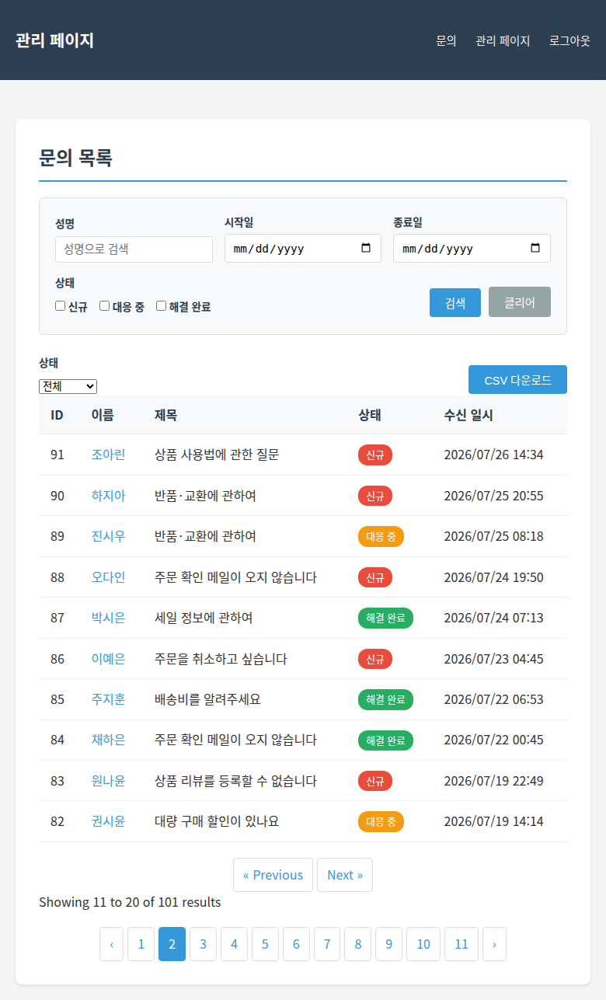

---

#### BT-12-4 검색 조건 유지

| 항목 | 내용 |
|------|------|
| 조작 순서 | 검색 실행 후 페이지네이션으로 2페이지로 이동한다 |
| 기대 결과 | 검색 조건이 유지된 상태로 2페이지가 표시된다 |
| 결과 | OK / NG |
| 비고 | |

**스크린숏:**

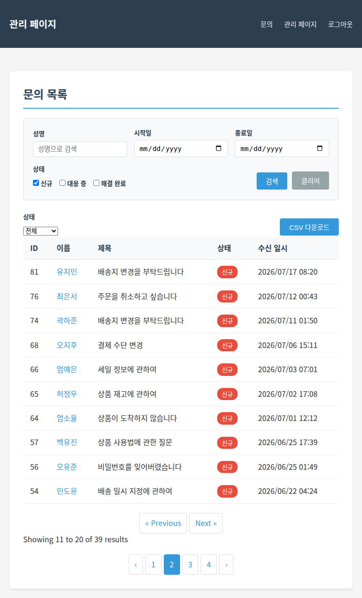

---

### BT-13 검색·필터

#### BT-13-1 이름으로 검색

| 항목 | 내용 |
|------|------|
| 조작 순서 | 이름란에 '민준'을 입력해 검색한다 |
| 기대 결과 | 이름에 '민준'이 들어간 문의만 표시된다 |
| 결과 | OK / NG |
| 비고 | |

**스크린숏:**

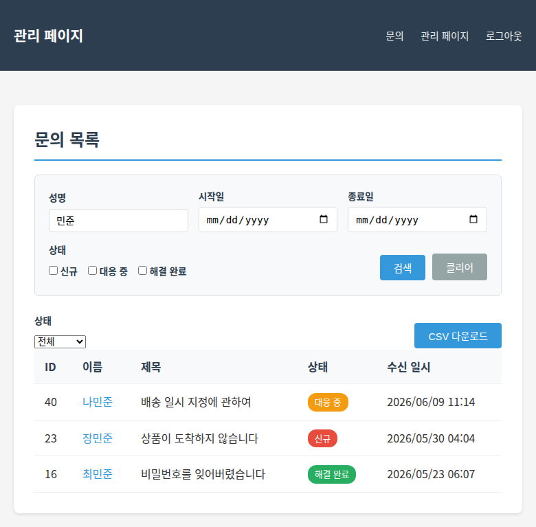

---

#### BT-13-2 이름 부분 일치

| 항목 | 내용 |
|------|------|
| 조작 순서 | 이름란에 '민'을 입력해 검색한다 |
| 기대 결과 | 이름에 '민'이 들어간 문의가 모두 표시된다 |
| 결과 | OK / NG |
| 비고 | |

**스크린숏:**

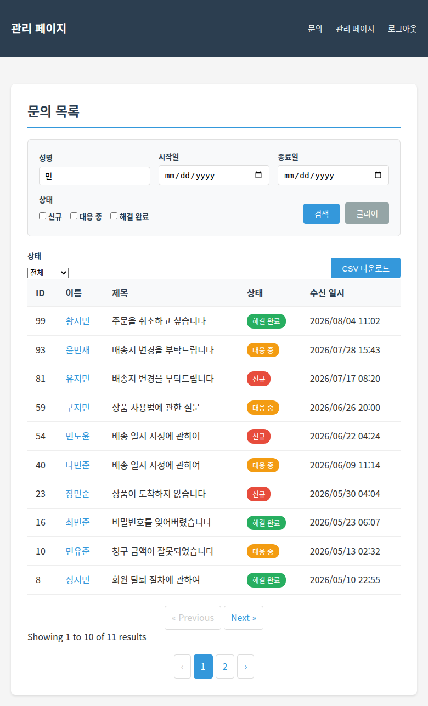

---

#### BT-13-3 날짜(시작일)로 필터링

| 항목 | 내용 |
|------|------|
| 조작 순서 | 시작일을 지정해 검색한다 |
| 기대 결과 | 지정일 이후의 문의만 표시된다 |
| 결과 | OK / NG |
| 비고 | |

**스크린숏:**

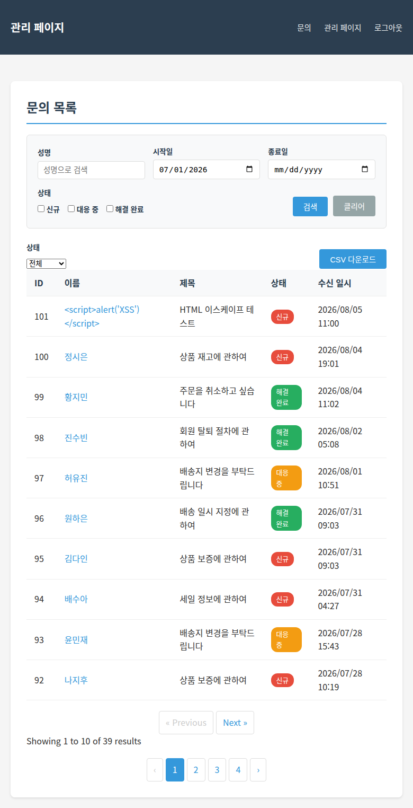

---

#### BT-13-4 날짜(종료일)로 필터링

| 항목 | 내용 |
|------|------|
| 조작 순서 | 종료일을 지정해 검색한다 |
| 기대 결과 | 지정일 이전의 문의만 표시된다 |
| 결과 | OK / NG |
| 비고 | |

**스크린숏:**

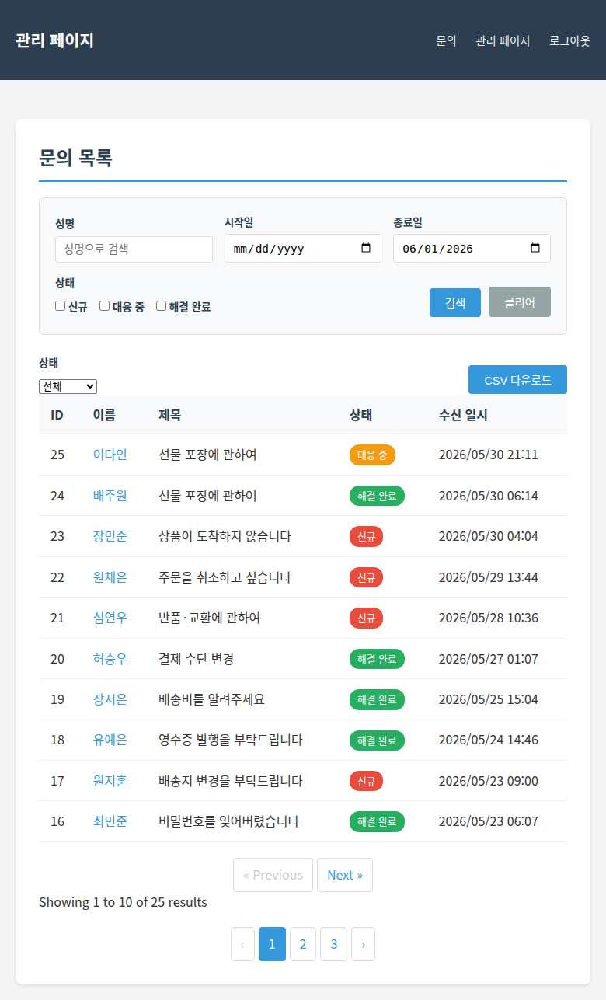

---

#### BT-13-5 날짜 범위로 필터링

| 항목 | 내용 |
|------|------|
| 조작 순서 | 시작일과 종료일을 지정해 검색한다 |
| 기대 결과 | 지정 기간 내의 문의만 표시된다 |
| 결과 | OK / NG |
| 비고 | |

**스크린숏:**

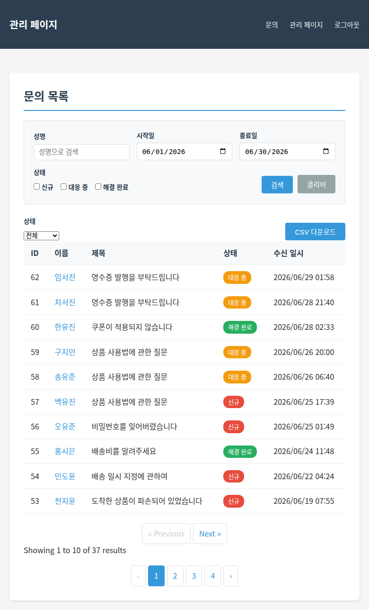

---

#### BT-13-6 상태로 필터링(단일)

| 항목 | 내용 |
|------|------|
| 조작 순서 | '신규' 체크박스만 체크해 검색한다 |
| 기대 결과 | 상태가 '신규'인 문의만 표시된다 |
| 결과 | OK / NG |
| 비고 | |

**스크린숏:**

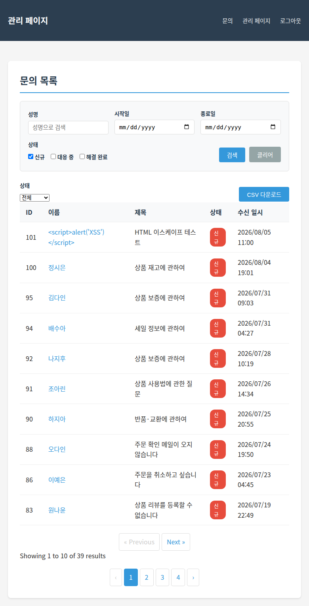

---

#### BT-13-7 상태로 필터링(복수)

| 항목 | 내용 |
|------|------|
| 조작 순서 | '신규'와 '대응 중'을 체크해 검색한다 |
| 기대 결과 | 상태가 '신규' 또는 '대응 중'인 문의가 표시된다 |
| 결과 | OK / NG |
| 비고 | |

**스크린숏:**

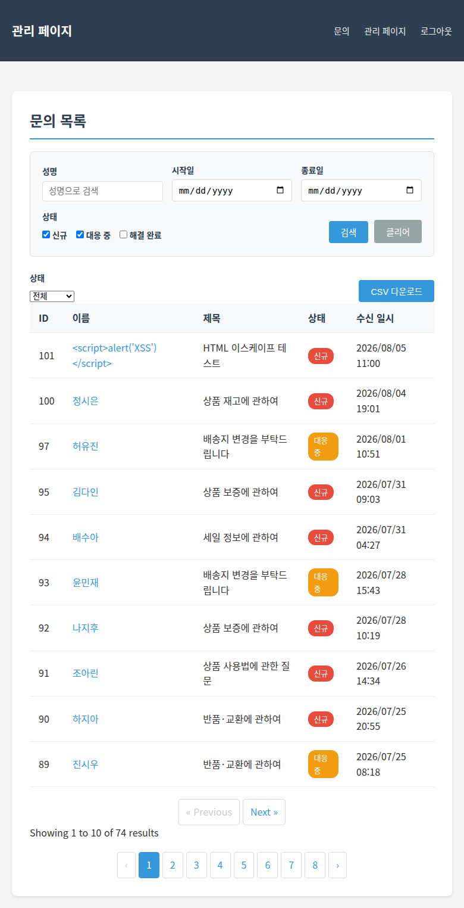

---

#### BT-13-8 복합 검색

| 항목 | 내용 |
|------|------|
| 조작 순서 | 이름·날짜·상태를 조합해 검색한다 |
| 기대 결과 | 모든 조건을 만족하는 문의만 표시된다 |
| 결과 | OK / NG |
| 비고 | |

**스크린숏:**

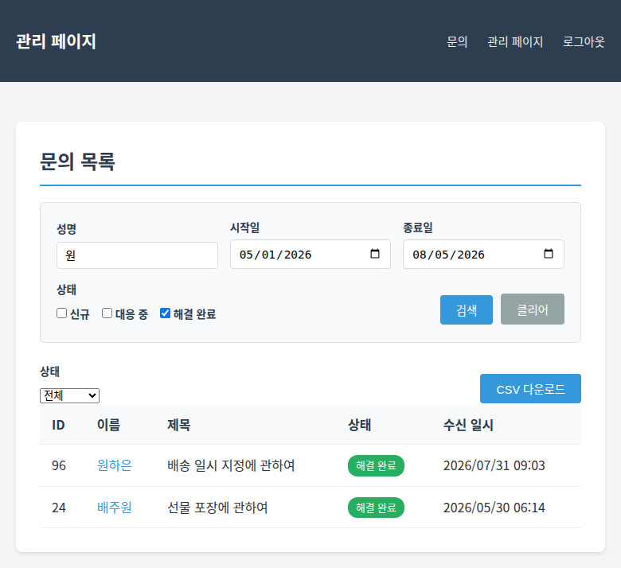

---

#### BT-13-9 검색 조건 클리어

| 항목 | 내용 |
|------|------|
| 조작 순서 | 검색 조건을 입력한 뒤 '클리어' 버튼을 누른다 |
| 기대 결과 | 검색 조건이 초기화되고 전체가 표시된다 |
| 결과 | OK / NG |
| 비고 | |

**스크린숏:**

---

#### BT-13-10 해당 없는 검색

| 항목 | 내용 |
|------|------|
| 조작 순서 | 존재하지 않는 이름으로 검색한다 |
| 기대 결과 | 검색 결과가 0건임이 표시된다(오류가 나지 않는다) |
| 결과 | OK / NG |
| 비고 | |

**스크린숏:**

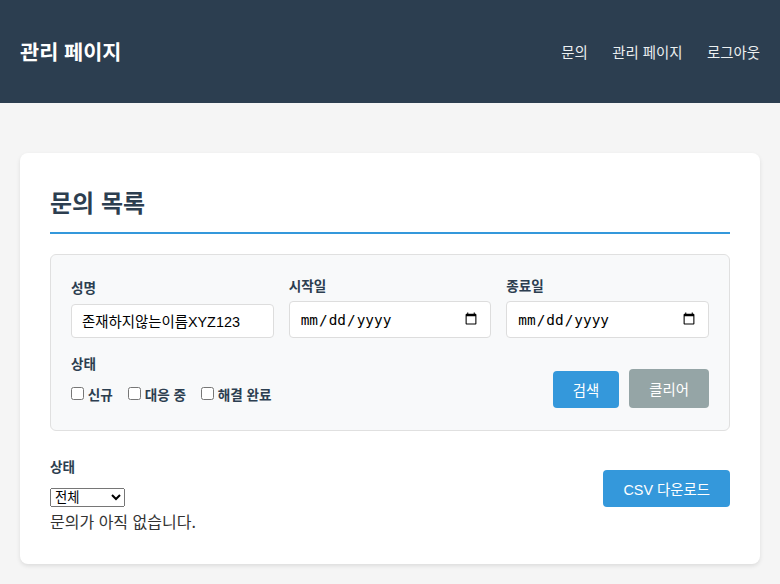

---

### BT-14 문의 상세

#### BT-14-1 상세 화면 표시

| 항목 | 내용 |
|------|------|
| 조작 순서 | 목록에서 임의의 문의를 클릭한다 |
| 기대 결과 | 상세 화면이 표시된다 |
| 결과 | OK / NG |
| 비고 | |

**스크린숏:**

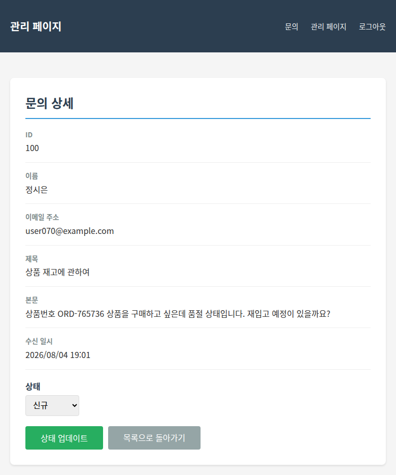

---

#### BT-14-2 표시 항목 확인

| 항목 | 내용 |
|------|------|
| 조작 순서 | 상세 화면의 표시 항목을 확인한다 |
| 기대 결과 | ID·이름·이메일 주소·제목·본문·수신 일시가 표시된다 |
| 결과 | OK / NG |
| 비고 | |

**스크린숏:**

---

#### BT-14-3 본문 줄바꿈 표시

| 항목 | 내용 |
|------|------|
| 조작 순서 | 줄바꿈이 있는 본문의 문의를 표시한다 |
| 기대 결과 | 줄바꿈이 반영된 상태로 표시된다 |
| 결과 | OK / NG |
| 비고 | |

**스크린숏:**

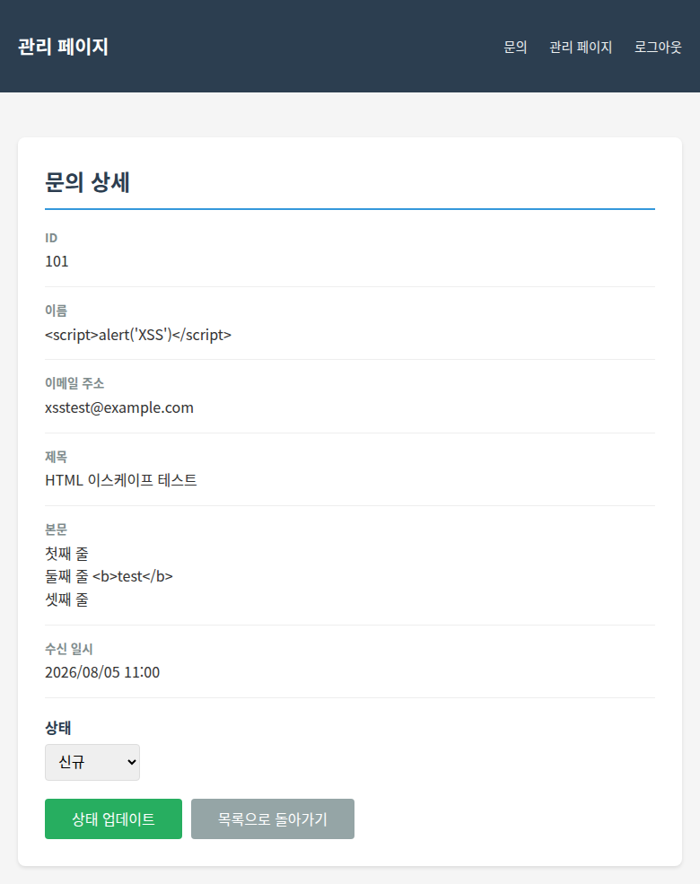

---

#### BT-14-4 HTML 이스케이프

| 항목 | 내용 |
|------|------|
| 조작 순서 | HTML 태그가 있는 본문의 문의를 표시한다 |
| 기대 결과 | HTML 태그가 이스케이프되어 스크립트가 실행되지 않는다 |
| 결과 | OK / NG |
| 비고 | |

**스크린숏:**

---

#### BT-14-5 상태 드롭다운

| 항목 | 내용 |
|------|------|
| 조작 순서 | 상세 화면의 상태란을 확인한다 |
| 기대 결과 | 드롭다운에 '신규' '대응 중' '해결 완료'가 표시된다 |
| 결과 | OK / NG |
| 비고 | |

**스크린숏:**

---

#### BT-14-6 현재 상태가 선택된 상태

| 항목 | 내용 |
|------|------|
| 조작 순서 | 상태가 '대응 중'인 문의의 상세를 연다 |
| 기대 결과 | 드롭다운에서 '대응 중'이 선택된 상태다 |
| 결과 | OK / NG |
| 비고 | |

**스크린숏:**

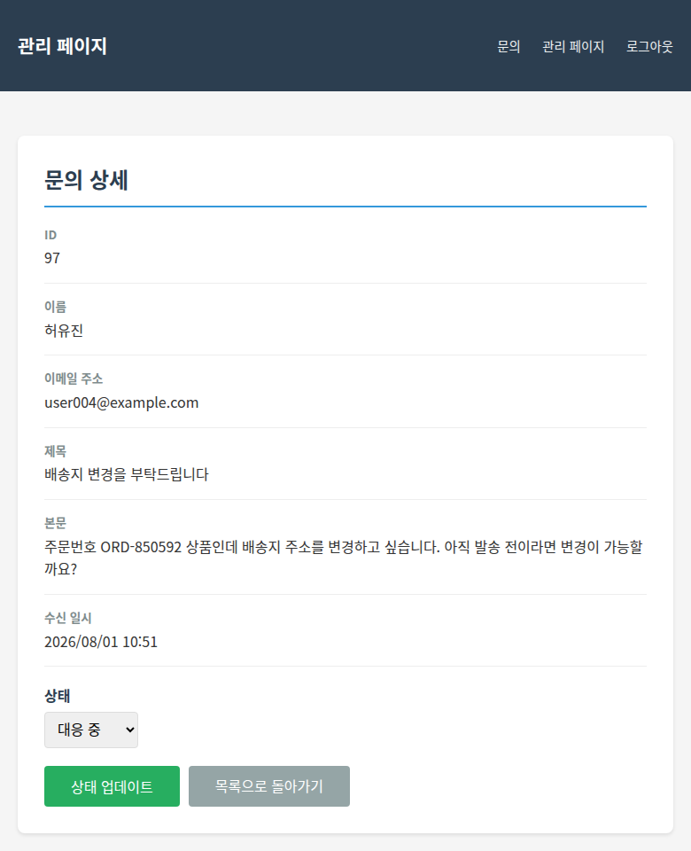

---

#### BT-14-7 '목록으로 돌아가기' 링크

| 항목 | 내용 |
|------|------|
| 조작 순서 | '목록으로 돌아가기' 링크를 클릭한다 |
| 기대 결과 | 문의 목록 화면으로 이동한다 |
| 결과 | OK / NG |
| 비고 | |

**스크린숏:**

---

#### BT-14-8 존재하지 않는 ID 접근

| 항목 | 내용 |
|------|------|
| 조작 순서 | 브라우저로 존재하지 않는 ID(예: `/admin/contacts/99999`)에 접근한다 |
| 기대 결과 | 404 오류가 반환된다 |
| 결과 | OK / NG |
| 비고 | |

**스크린숏:**

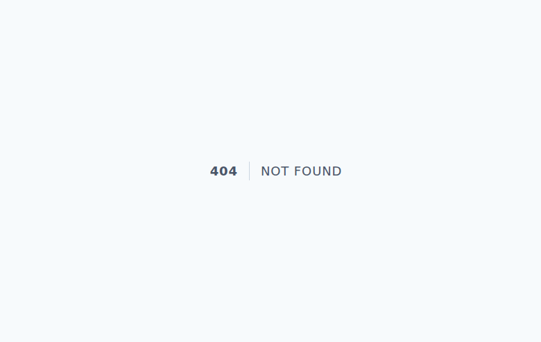

---

### BT-15 상태 업데이트

#### BT-15-1 '신규'→'대응 중'으로 변경

| 항목 | 내용 |
|------|------|
| 조작 순서 | 상태를 '대응 중'으로 바꾸고 업데이트 버튼을 누른다 |
| 기대 결과 | 상태가 '대응 중'으로 바뀌고 성공 메시지가 표시된다 |
| 결과 | OK / NG |
| 비고 | |

**스크린숏:**

---

#### BT-15-2 '대응 중'→'해결 완료'로 변경

| 항목 | 내용 |
|------|------|
| 조작 순서 | 상태를 '해결 완료'로 바꾸고 업데이트 버튼을 누른다 |
| 기대 결과 | 상태가 '해결 완료'로 바뀌고 성공 메시지가 표시된다 |
| 결과 | OK / NG |
| 비고 | |

**스크린숏:**

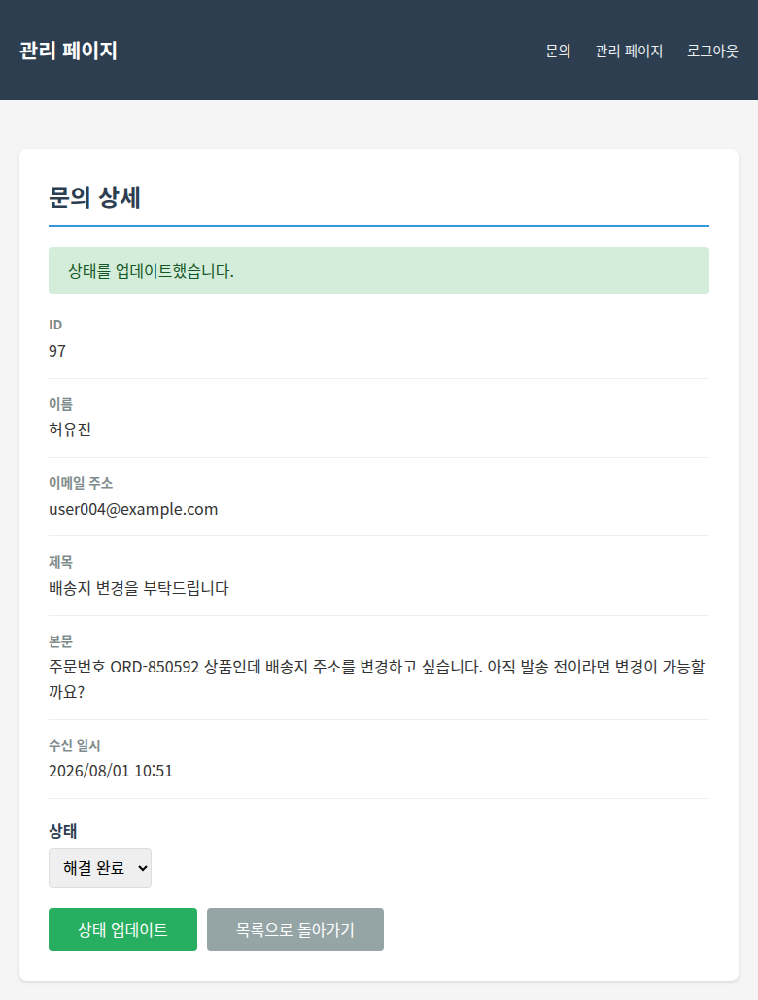

---

#### BT-15-3 '해결 완료'→'신규'로 변경

| 항목 | 내용 |
|------|------|
| 조작 순서 | 상태를 '신규'로 바꾸고 업데이트 버튼을 누른다 |
| 기대 결과 | 상태가 '신규'로 바뀌고 성공 메시지가 표시된다 |
| 결과 | OK / NG |
| 비고 | |

**스크린숏:**

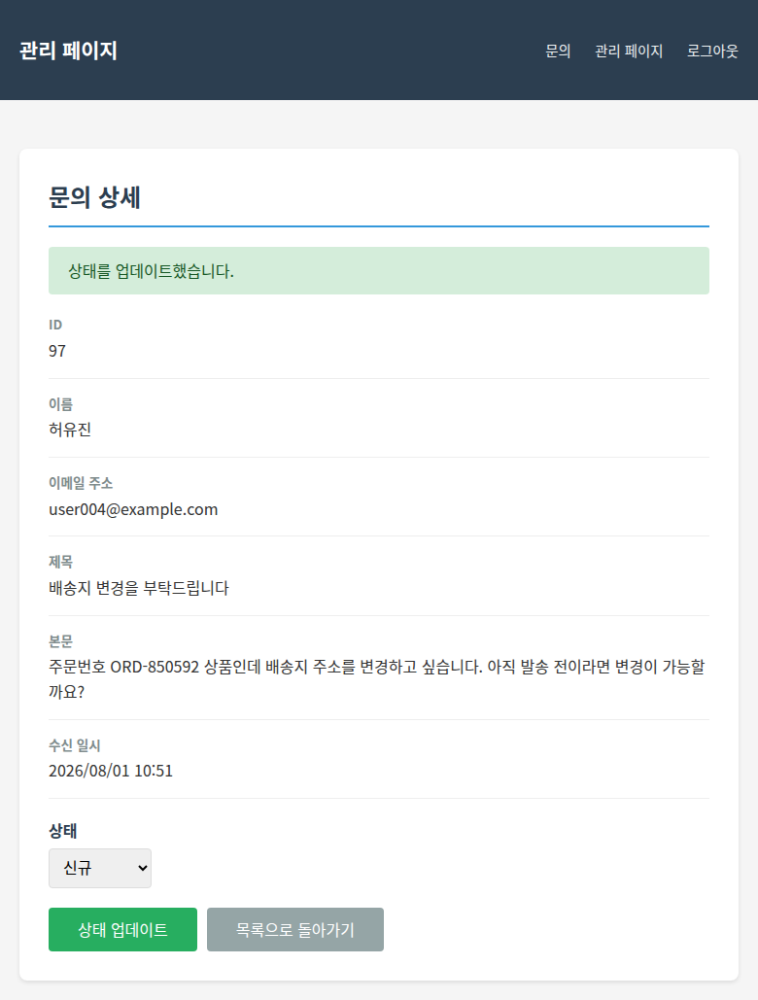

---

#### BT-15-4 성공 메시지 표시

| 항목 | 내용 |
|------|------|
| 조작 순서 | 상태를 업데이트한다 |
| 기대 결과 | '상태를 업데이트했습니다.'가 표시된다 |
| 결과 | OK / NG |
| 비고 | |

**스크린숏:**

---

#### BT-15-5 목록 반영 확인

| 항목 | 내용 |
|------|------|
| 조작 순서 | 상태 업데이트 후 목록 화면에서 확인한다 |
| 기대 결과 | 목록 화면에도 업데이트된 상태가 반영된다 |
| 결과 | OK / NG |
| 비고 | |

**스크린숏:**

---

### BT-16 로그아웃

#### BT-16-1 로그아웃 실행

| 항목 | 내용 |
|------|------|
| 조작 순서 | 헤더의 로그아웃 버튼을 누른다 |
| 기대 결과 | 로그인 화면으로 리다이렉트된다 |
| 결과 | OK / NG |
| 비고 | |

**스크린숏:**

---

#### BT-16-2 로그아웃 후 세션

| 항목 | 내용 |
|------|------|
| 조작 순서 | 로그아웃 후 관리 화면 URL에 직접 접근한다 |
| 기대 결과 | 로그인 화면으로 리다이렉트된다 |
| 결과 | OK / NG |
| 비고 | |

**스크린숏:**

---

## 종합 소견

| 항목 | 내용 |
|------|------|
| 종합 판정 | 합격 / 조건부 합격 / 불합격 |
| 특기 사항 | |
| 다음 대응 사항 | |

---

이상
